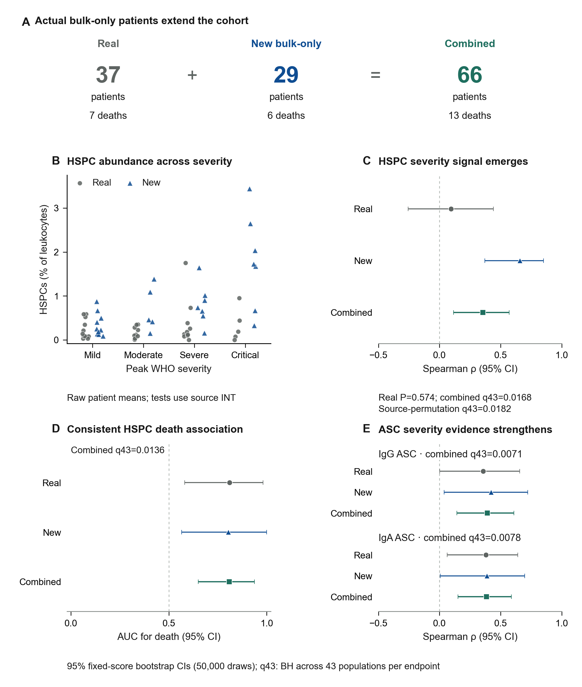
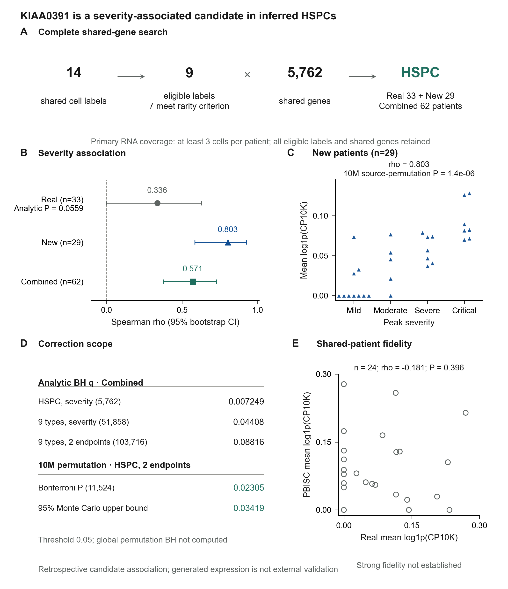

# Figure 7–8: unified rare-cell clinical association analysis

**PBISC-enabled inclusion of bulk-only patients reveals rare-HSPC and candidate transcriptomic associations with COVID-19 outcomes.**

This release implements the approved five-panel Figure 7, five-panel Figure 8, and five supplementary figures using the canonical `25-unified-v1.0` results. It is the current unified-analysis figure package; the repository's earlier Figure 7 versions remain historical analyses with different rules and scope.

## Read and view

- [Results and complete legends](docs/Results_and_Legends.md)
- [All seven figures in one PDF](figures/Figures_7_8_and_S1_S5.pdf)
- [한국어 서술·패널 구성안](docs/Positive_Narrative_KO.md), [English Results](docs/Results_Draft_EN.md)
- [Analysis methods and claim boundaries](docs/Methods_and_Interpretation.md)
- [Independent release checks](provenance/RELEASE_VALIDATION.json)

### Figure 7: rare-cell clinical associations



[PDF](figures/Figure_7.pdf) · [editable SVG](figures/Figure_7.svg) · [panel source data](source_data/)

### Figure 8: a candidate HSPC transcriptomic correlate of severity



[PDF](figures/Figure_8.pdf) · [editable SVG](figures/Figure_8.svg) · [panel source data](source_data/)

### Supplementary figures

| Figure | Content | Files |
|---|---|---|
| S1 | All 43 composition results, rarity and gain/loss context | [PNG](figures/Supplementary_Figure_S1.png) · [PDF](figures/Supplementary_Figure_S1.pdf) · [SVG](figures/Supplementary_Figure_S1.svg) |
| S2 | All 14 RNA-label coverage and nine-label shared-gene screen | [PNG](figures/Supplementary_Figure_S2.png) · [PDF](figures/Supplementary_Figure_S2.pdf) · [SVG](figures/Supplementary_Figure_S2.svg) |
| S3 | Tγδ ADK–severity and MXRA7–mortality FDR rescues | [PNG](figures/Supplementary_Figure_S3.png) · [PDF](figures/Supplementary_Figure_S3.pdf) · [SVG](figures/Supplementary_Figure_S3.svg) |
| S4 | Same29-patient bulk KIAA0391 context and shared-patient comparison | [PNG](figures/Supplementary_Figure_S4.png) · [PDF](figures/Supplementary_Figure_S4.pdf) · [SVG](figures/Supplementary_Figure_S4.svg) |
| S5 | All 16 unique HSPC modules and historical20-gene panel | [PNG](figures/Supplementary_Figure_S5.png) · [PDF](figures/Supplementary_Figure_S5.pdf) · [SVG](figures/Supplementary_Figure_S5.svg) |

S1–S5 identify supplements within this release; they do not overwrite the supplements of earlier figure versions.

## Main evidence

| Finding | Real-only | Combined | Interpretation |
|---|---|---|---|
| Rare HSPC abundance–severity | ρ=0.095, P=0.5742 | ρ=0.354, q43=0.0168 | Strict Real-missed association; source-permutation q43=0.01816 |
| HSPC KIAA0391–severity | ρ=0.336, P=0.05593 | ρ=0.571, within-HSPC q=0.007249 | Shared-panel transcriptomic candidate |
| HSPC abundance–mortality | AUC=0.810, q43=0.1327 | AUC=0.808, q43=0.01356 | FDR rescue with concordant effects |

Composition includes 37 Real+29 additional=66 patients/13 deaths/217 draws. HSPC RNA includes 33 Real+29 additional=62 patients. Generated cells and repeated draws are not independent sample-size units. HSPCs were already observed in35/37 Real patients: the new result concerns the clinical association. Rarity means both the Real mean and median leukocyte abundance are below 1%.

KIAA0391 passes analytic endpoint-global BH across 9×5,762 tests (q=0.04408), but not the two-endpoint global-joint family (q=0.08816). Fixed10M-scale source-restricted permutation gives Combined P=2.0×10⁻⁶ and full-HSPC two-endpoint Bonferroni P=.023048. This is not a full-screen permutation-BH calculation. The shared 24-patient expression correlation is ρ=-0.181; high individual expression-reconstruction fidelity is not established.

## Reproduce the figures

```bash
python -m pip install -r requirements.txt
python verify_release.py
python render_all.py
python verify_release.py --figures
```

All paths used for rendering are relative to this package. Original H5AD, NPZ patient matrices, generator weights, private runtime directories, and the original patient-ID mapping are not needed for figure regeneration and are not bundled. Plotting vectors use stable release-local pseudonyms; age and sex are excluded. The full primary association table contains 155,574 cohort×cell-type×gene records, including null results.

`verify_release.py` independently recomputes all 43 composition associations from the bundled patient scores, verifies RNA candidate statistics and the shared bridge, checks120 RNA BH column/family comparisons, and checks module and permutation correction formulas. It does not rerun all raw-expression calculations or the generator. Historical raw-data audits and the fixed 10M calculation are documented in `provenance/`.

The optional `stage_source_data.py --canonical PATH` exports the frozen source release again. It needs the original canonical directory; it is not part of ordinary figure regeneration. `write_documentation.py` regenerates publication documentation from the bundled tables.

## Interpretation

Strict Real-missed: Real P≥.05 and Combined primary q<.05. FDR rescue: Real q≥.05 and Combined primary q<.05; these definitions overlap. These labels describe observed threshold transitions, not a formal test of PBISC-specific augmentation benefit. The additional cohort contributes to discovery and is not independent replication. HSPC severity effects differ in magnitude across sources. Mortality AUCs are univariable associations and do not establish severity-independent prognosis or clinical utility.
