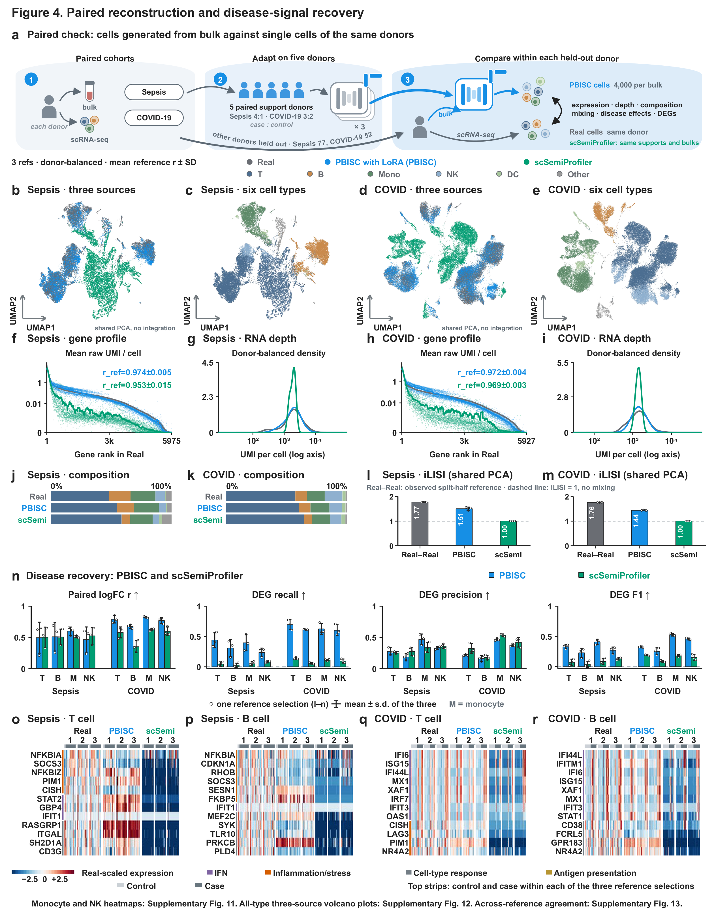
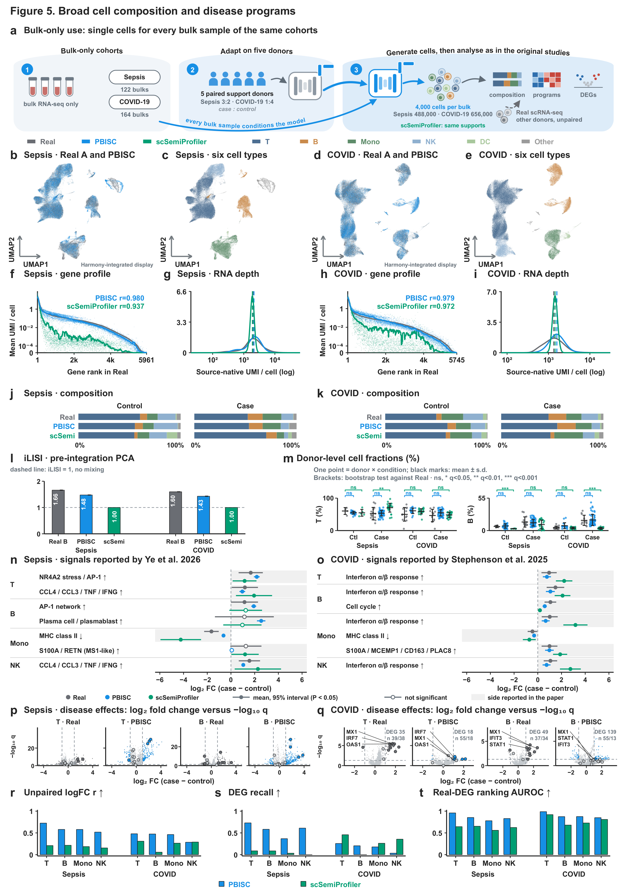
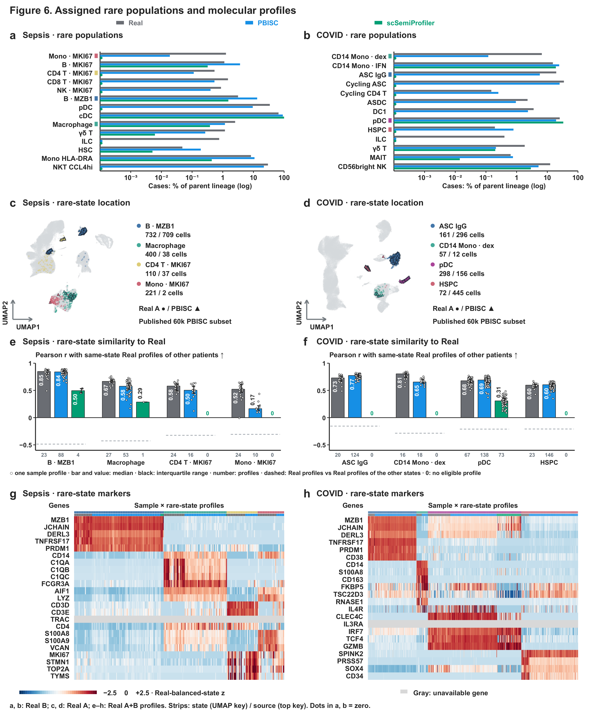
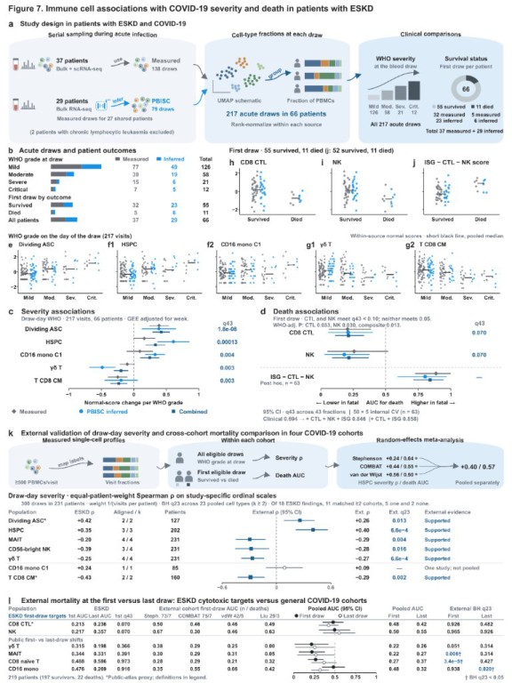

# PBISC Manuscript — Figures 4–7: Results, Main Figures & Figure Legends, Discussion, and Methods

> **Package scope**: Unified *Nature Portfolio* manuscript section covering **Results** (**Figures 4–7**), **Main Figures & Figure Legends** (**Figures 4–7**, with full-resolution figures embedded inline), **Discussion** (**Figures 4–7**), **Methods** (**Figures 4–7**), **Supplementary Figures 8–27 Overview**, and **PubMed-verified References** (`1–20`, numbered in strict order of first citation).  
> **Verification status**: Independently recomputed and cross-audited on `2026-11-25` across master vector graphics (`PBISC-Diffusion_20261123.pdf` Pages 8–15, 32–71 and finalized `Figure 7`), raw single-cell/sample-level matrices, archived differential expression tables, DerSimonian–Laird external meta-analyses, and fixed-feature internal cross-validation (`VERIFICATION_FINAL_FIG4_7_20261125.json`).

---

## Results

### Paired clinical cohorts assess cell-type-resolved reconstruction and disease-signal recovery

To evaluate whether adapting the pretrained `6,000`-gene (`1×`) `PBISC` diffusion model on a minimal paired reference reconstructs donor-specific single-cell transcriptomes and recovers cell-type-resolved disease effects from bulk RNA-seq, we first benchmarked paired clinical cohorts in which the same individuals were profiled by both peripheral blood bulk RNA-seq and PBMC scRNA-seq (**Fig. 4a** and **Supplementary Figs. 8–13**): bacterial sepsis¹ and end-stage kidney disease (`ESKD`) COVID-19²,³ (with two smaller paired benchmarks, `Giroux` and `Ji [ChILI]`, examined for support-allocation and sample-size boundary conditions in **Supplementary Figs. 8 and 9**). In each cohort, five paired support donors adapted the pretrained `PBISC` model via low-rank adaptation (`LoRA`, stage 2) across three prespecified reference selections chosen strictly by endpoint availability rather than metric magnitude (**Supplementary Fig. 8a,b,e**): Sepsis `D0`, `D1` and `D3` (`4` adult sepsis cases and `1` healthy control support donor per selection: `HC07`, `HC12` or `PHC05`) and COVID-19 `D0`, `D1` and `D4` (`3` COVID-19-positive and `2` COVID-19-negative ESKD support donors per selection: `C106/C237`, `C142/C164` or `C152/C137`). Conditioning `PBISC` (`×1` bulk inputs with support-gated ceiling counts) generated `4,000` single cells for every held-out bulk sample (`77` held-out Sepsis donors [`77` visits] per reference and `52` held-out COVID-19 donors [`142–143` visits] per reference), which were compared directly against the observed (`Real`) single cells of the **same held-out donor** and against `scSemiProfiler`⁴ conditioned on the identical five support donors and held-out bulk samples (stage 3; **Fig. 4a**).

Without applying Harmony or any post-hoc source integration, two-dimensional UMAP projections of the saved `50`-dimensional three-source **PRE-PCA** representation (`D0`: `11,550` cells per source across `77` Sepsis visits and `21,250` cells per source across `142` COVID-19 visits; **Fig. 4b–e**) showed that `PBISC` cells co-localized directly with observed `Real` cells across all six broad immune compartments (`T`, `B`, `Monocyte`, `NK`, `DC` and `Other`), whereas `scSemiProfiler` cells segregated into displaced source-specific clusters (**Fig. 4b,d**). Quantifying matched source mixing directly in each reference selection's `50`-dimensional **PRE-PCA** space (`≤ 75` cells per disjoint observed visit half; **Fig. 4l,m**), `PBISC` achieved three-reference mean **`iLISI = 1.51`** in Sepsis (versus the within-visit empirical split-half reference `Real–Real` **`1.77`**) and **`iLISI = 1.44`** in COVID-19 (versus `Real–Real` **`1.76`**), whereas `scSemiProfiler` remained completely unmixed at **`iLISI = 1.00`** in both cohorts (matching the dashed `iLISI = 1` no-mixing baseline). Across `5,975` shared Sepsis genes and `5,927` shared COVID-19 genes ranked by `Real` expression (retaining zero means; **Fig. 4f,h**), donor-balanced `PBISC` profiles accurately tracked four orders of magnitude of mean raw UMI counts per cell (`unsmoothed log1p` reference-mean Pearson **`r_ref = 0.974 ± 0.005`** versus **`0.953 ± 0.015`** for `scSemiProfiler` in Sepsis, and **`0.972 ± 0.004`** versus **`0.969 ± 0.003`** in COVID-19), reproduced the broad observed per-cell UMI-depth distribution across `10²–10⁴` UMIs rather than collapsing onto `scSemiProfiler`'s narrow unimodal count spike (**Fig. 4g,i**), and preserved donor-balanced six-type PBMC compositions (**Fig. 4j,k**; Sepsis `Real`: `48.4% T`, `17.6% B`, `20.7% Mono`, `7.9% NK`, `0.5% DC`, `4.9% Other` versus `PBISC`: `54.8%, 14.0%, 20.8%, 5.9%, 0.5%, 4.0%`, whereas `scSemiProfiler` depleted `B` cells by more than half to `7.0%`; COVID-19 `Real`: `57.3%, 9.5%, 14.7%, 14.6%, 2.6%, 1.3%` versus `PBISC`: `60.3%, 9.4%, 15.7%, 10.3%, 2.9%, 1.3%`, whereas `scSemiProfiler` reduced `B` cells to `6.5%`; multi-endpoint paired reconstruction metrics across cohorts in **Supplementary Fig. 9a–g** and `72`-gene donor-level immune-program covariance in **Supplementary Fig. 10**).

Crucially, we tested whether generated single cells recover cell-type-resolved `case − control` transcriptional effects within the same held-out donors using trimmed mean of *M*-values (`TMM`)⁵ normalization and `limma-voom`⁶,⁷ moderated linear models (`BH-adjusted P < 0.05`, no fold-change cutoff) across identical cell-type-specific visit masks and observed-defined gene families (**Fig. 4n–r** and **Supplementary Figs. 11–13**). Across `T`, `B`, `Monocyte` and `NK` cells in **COVID-19** (**Fig. 4n**), `PBISC` substantially outperformed `scSemiProfiler` on three-reference mean **paired `logFC r`** (`0.79`, `0.68`, `0.82` and `0.77` versus `0.58`, `0.35`, `0.63` and `0.60`), **DEG `recall`** (`0.70`, `0.62`, `0.63` and `0.60` versus `0.14`, `0.06`, `0.11` and `0.09`), and harmonic-mean **DEG `F1`** (`0.33`, `0.25`, `0.53` and `0.46` versus `0.19`, `0.09`, `0.18` and `0.15`). In **Sepsis** (**Fig. 4n**), where both methods achieved similar paired `logFC r` (`PBISC`: `0.50`, `0.51`, `0.60` and `0.47` versus `scSemiProfiler`: `0.50`, `0.51`, `0.51` and `0.52`), `scSemiProfiler` suffered severe sensitivity loss (`D0` volcano calls of only `33`, `9`, `147` and `76` DEGs versus `818`, `422`, `980` and `425` observed `Real` DEGs and `811`, `956`, `483` and `379` `PBISC` DEGs; **Supplementary Fig. 12**), so `PBISC` achieved three- to twelvefold higher **DEG `recall`** (`0.44`, `0.31`, `0.40` and `0.24` versus `0.05`, `0.03`, `0.05` and `0.08`) and superior **DEG `F1` across all four cell types** (`0.33`, `0.23`, `0.41` and `0.27` versus `0.07`, `0.04`, `0.09` and `0.13`, despite slightly higher raw `precision` in sparsely calling `scSemiProfiler` subsets; **Fig. 4n**). Three-reference mean native disease-effect comparisons across the full observed gene intersections (`2,514–4,167` genes per cell type; **Supplementary Fig. 13**) likewise confirmed higher concordance for `PBISC` across all four COVID-19 lineages (`r = 0.80–0.87`, Lin's concordance correlation `CCC = 0.79–0.85` versus `scSemiProfiler` `r = 0.41–0.68`, `CCC = 0.37–0.64`) and in Sepsis `T`, `B` and `Monocyte` lineages (`PBISC` `r = 0.64–0.72, CCC = 0.56–0.63` versus `scSemiProfiler` `r = 0.62–0.64, CCC = 0.58–0.62`; Sepsis `NK` `0.58 / 0.54` versus `0.66 / 0.59`). Donor-condition pseudobulk heatmaps across `12` `Real`-selected disease-program genes per cell type (**Fig. 4o–r** for `T` and `B` cells; **Supplementary Fig. 11** for `Monocyte` and `NK` cells) demonstrated faithful across-reference recovery of Sepsis inflammatory/stress induction (`NFKBIA`, `SOCS3`, `NFKBIZ`, `PIM1`, `CDKN1A`, `FKBP5`, `PRKCB`) alongside `T`-cell receptor signalling repression (`RASGRP1`, `ITGAL`, `SH2D1A`, `CD3G`) and COVID-19 type-I interferon/plasmablast activation (`IFI6`, `ISG15`, `IFI44L`, `MX1`, `XAF1`, `IRF7`, `IFIT3`, `OAS1`, `STAT1`, `CD38`, `FCRL5`), whereas `scSemiProfiler` introduced pronounced cross-donor block artefacts.

---

### Broad cell composition, disease programs and unpaired differential expression in bulk-only sepsis and COVID-19 cohorts

Having established within-donor reconstruction and `limma-voom` disease-signal recovery on paired cohorts (**Fig. 4**), we deployed five-donor-adapted `PBISC` in its intended bulk-only setting across all specimens profiled solely by bulk RNA sequencing in the same two clinical studies (**Fig. 5a** and **Supplementary Fig. 14a–d**). Conditioning `PBISC` (`×1` bulk inputs with support-gated ceiling counts) after five-donor `LoRA` adaptation (`1` fixed support selection per cohort: `disease:control = 3:2` in bacterial sepsis¹ and `1:4` in ESKD COVID-19²,³) yielded `4,000` generated single cells for each of `122` bulk-only whole-blood samples in bacterial sepsis (`488,000` `PBISC` cells across `68` adult sepsis, `17` adult non-septic intensive care unit [`ICU`], `36` adult healthy control and `1` paediatric ICU sample `PIC06`) and `164` bulk-only peripheral blood samples in ESKD COVID-19 (`656,000` `PBISC` cells across `143` COVID-19-positive, `19` COVID-19-negative and `2` recovery visits). We analysed cell-type composition, published disease programs and differentially expressed genes (`DEGs`) using the same study-level workflows and compared them against observed (`Real`) scRNA-seq from unmatched specimens (`633,072` adult sepsis cells across `108` samples and `578,835` COVID-19 cells across `187` samples) and against `scSemiProfiler`⁴ conditioned on the identical five support donors (`51,000` sepsis cells across `34` samples and `60,000` COVID-19 cells across `102` samples, retaining its archived Poisson-count representation), making this cross-sample evaluation strictly unpaired at the specimen level (with zero shared donors in sepsis and seven longitudinal COVID-19 donors—`C113`, `C127`, `C145`, `C168`, `C169`, `C20` and `C63`—contributing unmatched visits across the `Real B` and `PBISC` composition subsets; **Fig. 5a**).

In the post-Harmony⁸ display UMAPs combining the `Real A` annotation reference (`58,195` sepsis cells and `57,613` COVID-19 cells) with the published `60,000`-cell `PBISC` display subset per cohort, generated cells co-localized across all six frozen broad cell types (`T`, `B`, `Monocyte`, `NK`, `DC` and `Other`; **Fig. 5b–e**). Because post-Harmony coordinates reflect explicit integration and are shown for visual orientation only, we quantified native source mixing directly in `Real-A`-fitted `30`-dimensional **pre-integration PCA** space across `2,000` `Real-A` highly variable genes (`HVGs`), adopting no post-Harmony statistic (**Fig. 5l**). Averaging three query-seed median `iLISI` values against `Real A` (`58,195` sepsis and `57,613` COVID-19 cells), `PBISC` (`60,000` cells per cohort) achieved **`iLISI = 1.48`** compared with the donor-disjoint observed evaluation subset `Real B` (`59,457` cells; **`1.66`**) in sepsis and **`iLISI = 1.43`** compared with `Real B` (`56,171` cells; **`1.60`**) in COVID-19, whereas `scSemiProfiler` (`51,000` and `60,000` cells) showed zero unintegrated source mixing in both cohorts (**`iLISI = 1.00`**, matching the dashed `iLISI = 1` no-mixing baseline). Across `5,961` shared sepsis genes and `5,745` shared COVID-19 genes ranked by `Real` expression (retaining zero means), `PBISC` preserved four orders of magnitude of mean raw UMI counts per cell (`unsmoothed log1p` Pearson **`r = 0.980`** versus **`0.937`** for `scSemiProfiler` in sepsis [`0.936` in the thinned display-curve table], and **`r = 0.979`** versus **`0.972`** in COVID-19; **Fig. 5f,h**), while reproducing the broad empirical per-cell library-depth distribution across `10²–10⁴` UMIs (`Supplementary Fig. 14e–h` full-source panel UMI medians: `PBISC 2,121` versus `Real 2,042` and `scSemiProfiler 1,901` in sepsis; `PBISC 1,592` versus `Real 1,338` and `scSemiProfiler 1,439` in COVID-19) rather than collapsing onto `scSemiProfiler`'s narrow unimodal Poisson spike (**Fig. 5g,i**).

Summarizing six-type compositions per visit, averaging within each `donor × condition` unit, and weighting donors equally (`297` total donor–condition units: case/control donor counts of `14/4`, `68/36` and `26/5` in sepsis and `12/12`, `57/19` and `22/22` in COVID-19 for `Real B`, `PBISC` and `scSemiProfiler`, respectively; **Fig. 5j,k**), `PBISC` closely tracked observed case–control compositional remodelling—including B-cell and monocyte expansion from control to sepsis (`PBISC`: `7.8% → 13.2%` B and `10.7% → 17.7%` monocyte versus `Real B`: `6.9% → 14.5%` B and `10.4% → 18.4%` monocyte) and B-cell expansion with NK contraction in COVID-19 (`PBISC`: `8.2% → 18.0%` B and `14.3% → 8.2%` NK versus `Real B`: `5.0% → 17.3%` B and `19.4% → 16.1%` NK). In two-sided centered patient-block bootstrap tests against `Real B` (`49,999` resamples; Benjamini–Hochberg `BH q` across `24` tests per cohort; **Fig. 5m** and **Supplementary Fig. 15a**), no statistically significant compositional distortion (`ns`, `q ≥ 0.05`) was detected for `PBISC` in either `T` or `B` cell fractions across all four cohort-by-condition groups (`Sepsis Ctl/Case` and `COVID Ctl/Case`), whereas `scSemiProfiler` significantly inflated `T` cells in sepsis cases (`70.5%` versus `52.4%` in `Real B`, `q < 0.01`) and severely depleted `B` cells in both sepsis controls (`3.1%` versus `6.9%`, `q < 0.001`) and COVID-19 cases (`3.7%` versus `17.3%`, `q < 0.001`).

We next tested whether bulk-only `PBISC` profiles recover the cell-type-specific disease transcriptional signals originally reported by the cohort studies on donor–condition pseudobulks (`≥ 10` cells per type; mean `log2(CPM + 1)`, two-sided Welch's *t*-test of `case − control`; **Fig. 5n,o** and **Supplementary Fig. 15b–i**). Across the seven sepsis signals reported by Ye et al.¹ (**Fig. 5n**), `PBISC` significantly (`P < 0.05` on the published side) reproduced **`6` of `7`** programs—`T`-cell `NR4A2 stress / AP-1 ↑` (`mean log2 FC = +2.18` versus `+1.67` in `Real B`), `T`-cell `CCL4 / CCL3 / TNF / IFNG ↑` (`+0.96` versus `+1.18`), `B`-cell `AP-1 network ↑` (`+1.92` versus `+1.14`, whereas `scSemiProfiler` `+1.25` was non-significant), `B`-cell `Plasma cell / plasmablast ↑` (`+2.55`, `P < 0.05`, versus `+1.14` in `Real B` with wide confidence intervals from four controls and `+0.97` [`ns`] in `scSemiProfiler`), `Monocyte` `MHC class II ↓` (`−0.63` versus `−1.65` in `Real B`, whereas `scSemiProfiler` exaggerated repression to `−4.24`), and `NK`-cell `CCL4 / CCL3 / TNF / IFNG ↑` (`+1.04` versus `+1.56`)—whereas `PBISC` showed a near-zero mean difference on the `Monocyte` `S100A / RETN (MS1-like) ↑` row (`+0.07` [`ns`] versus `+1.26` [`ns`, wide `4`-control interval] in `Real B` and `+1.19` [`P < 0.05`] in `scSemiProfiler`). Across all seven COVID-19 signals reported by Stephenson et al.³ (**Fig. 5o**, evaluating Reactome `Interferon α/β` [`34` of `78` genes] and `Cell cycle` [`160` of `688` genes] from MSigDB `v2026.1`), `PBISC` significantly recovered **`7` of `7`** published shifts with well-calibrated effect sizes matching `Real B`—including `Interferon α/β response ↑` across `T` (`+0.77` versus `+0.95`), `B` (`+1.06` versus `+1.49`), `Monocyte` (`+0.67` versus `+1.01`) and `NK` (`+0.74` versus `+1.07`) compartments, `B`-cell `Cell cycle ↑` (`+0.59` versus `+1.07`), `Monocyte` `MHC class II ↓` (`−0.31` versus `−0.45`), and `Monocyte` `S100A / MCEMP1 / CD163 / PLAC8 ↑` (`+0.98` versus `+0.99`)—whereas `scSemiProfiler` inflated `Interferon α/β` fold changes two- to threefold (`+2.23` in `T`, `+2.09` in `B`, `+3.18` in `Monocyte` and `+2.75` in `NK`) while attenuating `B`-cell `Cell cycle ↑` (`+0.18`).

Finally, we compared unpaired per-gene pseudobulk disease tests across `5,664` sepsis panel genes and `5,610` COVID-19 panel genes (`≥ 20` cells per visit and cell type; Welch's *t*-test on `log2(CPM + 1)` against the archived full observed `Real` pseudobulk cohort, calling DEGs at `BH q < 0.05` and `|log2 FC| ≥ 1`; **Fig. 5p–t** and **Supplementary Figs. 16 and 17**). Side-by-side `T`- and `B`-cell volcano plots confirmed concordant upregulation and repression landscapes between `Real` and `PBISC` in sepsis (`T`: `104` `Real` DEGs [`n = 93/7`] and `217` `PBISC` DEGs [`n = 68/36`]; `B`: `139` `Real` DEGs [`n = 93/7`] and `437` `PBISC` DEGs [`n = 68/30`]; **Fig. 5p** and **Supplementary Fig. 16c–f**) and selective recovery of top interferon-stimulated DEGs (`MX1`, `IRF7`, `OAS1`, `IFIT3`, `STAT1`) in COVID-19 (`T`: `35` `Real` DEGs [`n = 39/38`] and `18` `PBISC` DEGs [`n = 55/18`]; `B`: `49` `Real` DEGs [`n = 37/34`] and `139` `PBISC` DEGs [`n = 55/13`]; **Fig. 5q** and **Supplementary Fig. 17c–f**). Across `T`, `B`, `Monocyte` and `NK` populations in sepsis (**Fig. 5r–t**, left), `PBISC` substantially outperformed `scSemiProfiler` on unattenuated **unpaired `logFC r`** versus archived `Real` pseudobulk effects (`0.73`, `0.58`, `0.58` and `0.52` versus `0.21`, `0.21`, `0.19` and `0.15`), **DEG `recall`** (`0.73`, `0.58`, `0.37` and `0.61` versus `0.09`, `0.09`, `0.03` and `0.00`, with `scSemiProfiler` calling `0` NK DEGs), and threshold-free **`Real`-DEG ranking `AUROC`** (`0.96`, `0.86`, `0.78` and `0.83` versus `0.64`, `0.65`, `0.56` and `0.62`; split-half disattenuated `r = 0.66–0.81` and corrected slopes `0.71–1.11` in **Supplementary Fig. 16b**). In COVID-19 (**Fig. 5r–t**, right), `PBISC` achieved higher **`Real`-DEG ranking `AUROC`** across every cell type (`0.99`, `0.87`, `0.88` and `0.85` for `T`, `B`, `Monocyte` and `NK` versus `0.92`, `0.68`, `0.73` and `0.81` for `scSemiProfiler`) and higher **unpaired `logFC r`** in `T` (`0.48` versus `0.31`), `B` (`0.47` versus `0.06`) and `Monocyte` (`0.46` versus `0.26`) compartments (`0.29` versus `0.29` in `NK`; split-half disattenuated `r = 0.58–0.83` versus `0.09–0.39` in **Supplementary Fig. 17b**); although `scSemiProfiler` showed numerically higher raw `DEG recall` in `T` (`0.46` versus `0.26`), `Monocyte` (`0.26` versus `0.18`) and `NK` (`0.36` versus `0.03`) under the `|log2 FC| ≥ 1` cutoff, this reflected variance-inflated calling of `170`, `168` and `172` DEGs, while `scSemiProfiler` recovered **`0` overlapping `B`-cell DEGs** (`recall = 0.00` versus `0.20` for `PBISC`).

---

### Assigned rare populations and inter-patient molecular profiles across sepsis and COVID-19 samples

A stringent test of bulk-conditioned single-cell synthesis is whether rare immune states (`<0.05%` to `2%` of total PBMCs) are preserved with state-specific molecular profiles rather than absorbed into dominant lineage centroids (**Fig. 6** and **Supplementary Figs. 18 and 19**). Using observed recap annotations in `Real B` and frozen reference-transferred annotations in generated sources—where `PBISC` generated `488,000` sepsis and `656,000` COVID-19 cells, the frozen COVID-19 primary-scope flag excludes three `C31` visits (`12,000` cells) to leave `644,000` eligible COVID-19 cells prior to condition filtering, and pooled case-only analyses span **`272,000` sepsis** and **`560,000` COVID-19** `PBISC` cells—we quantified pooled case-cell abundances across `14` prespecified rare states in sepsis and `13` rare states in COVID-19 from exact integer cell counts as percentages of their parent lineage, using all case cells as the denominator for `HSC` and `HSPC` (**Fig. 6a,b**). In sepsis cases (**Fig. 6a**), `PBISC` populated **`13` of `14`** reference-assigned rare states—spanning `B · MZB1` plasmablasts (`13.24%` of `B + plasma` versus `3.15%` in `Real B`), `B · MKI67` (`3.66%` versus `1.13%`), `CD4 T · MKI67` (`0.11%` versus `0.54%`), `CD8 T · MKI67` (`0.54%` versus `1.48%`), `NK · MKI67` (`0.40%` versus `0.88%`), `Mono · MKI67` (`0.019%` versus `1.27%`), `pDC` (`9.53%` versus `34.29%` of `DC`), `cDC` (`90.47%` versus `65.71%`), `Macrophage` (`1.18%` versus `2.54%`), `γδ T` (`0.27%` versus `1.18%`), `HSC` (`0.192%` versus `0.048%` of all cells), `Mono HLA-DRA` (`10.82%` versus `8.31%`) and `NKT CCL4hi` (`21.91%` versus `29.66%`), lacking only innate lymphoid cells (`ILC`, `0%` versus `0.77%`)—whereas `scSemiProfiler` collapsed to **true zero counts in `7` of `14` sepsis states** (`Mono · MKI67`, `CD4 T · MKI67`, `CD8 T · MKI67`, `NK · MKI67`, `pDC`, `ILC` and `NKT CCL4hi`). Similarly, in COVID-19 cases (**Fig. 6b**), `PBISC` populated **`12` of `13`** rare states—including `CD14 Mono · dex` (`0.12%` of `CD14 mono` versus `6.66%` in Wave-2 dexamethasone-treated `Real B`), `CD14 Mono · IFN` (`24.52%` versus `15.24%`), `ASC IgG` (`5.72%` of plasmablasts versus `19.62%`), `Cycling ASC` (`25.26%` versus `34.86%`), `Cycling CD4 T` (`0.25%` versus `0.15%`), `ASDC` (`0.95%` versus `2.27%`), `DC1` (`2.34%` versus `3.58%`), `pDC` (`19.37%` versus `25.44%`), `HSPC` (`0.79%` versus `0.20%` of all cells), `γδ T` (`0.21%` versus `1.84%`), `MAIT` (`0.76%` versus `0.64%`) and `CD56bright NK` (`5.18%` versus `12.42%`), lacking only `ILC` (`0%` versus `0.40%`)—whereas `scSemiProfiler` collapsed to **true zero counts in `8` of `13` COVID-19 states** (`CD14 Mono · dex`, `ASC IgG`, `Cycling ASC`, `Cycling CD4 T`, `ASDC`, `DC1`, `HSPC` and `ILC`; donor-level rare-population comparisons across clinical groups in **Supplementary Fig. 18**).

Within the saved post-Harmony UMAP coordinates of `Real A` and the published `60,000`-cell `PBISC` display subset, generated rare cells localized onto the exact micro-regions occupied by observed cells across four representative states per cohort: `B · MZB1` (`732` `Real A` / `709` `PBISC` cells), `Macrophage` (`400 / 38`), `CD4 T · MKI67` (`110 / 37`) and `Mono · MKI67` (`221 / 2`) in sepsis (**Fig. 6c**), and `ASC IgG` (`161 / 296`), `CD14 Mono · dex` (`57 / 12`), `pDC` (`298 / 156`) and `HSPC` (`72 / 445`) in COVID-19 (**Fig. 6d**). To test directly whether individual sample-by-state profiles capture state-specific transcriptional structure beyond generic parent-lineage background, we summed raw counts on the shared measured-gene panel (`ln(1 + CP10K)`) across `270` eligible sepsis profiles and `625` eligible COVID-19 profiles (`≥ 3` cells required, except `COVID CD14 Mono · dex` [`≥ 2`] and `Sepsis Mono · MKI67` [`≥ 1`]), subtracted a state-balanced `Real-A+B` gene baseline across the `2,000` frozen `Real-A` HVGs, and computed each profile's median Pearson correlation with same-state `Real A+B` profiles from **other patients** (strictly excluding its own patient; **Fig. 6e,f**). In sepsis (**Fig. 6e**), `PBISC` closely tracked the `Real` inter-patient similarity benchmark in `B · MZB1` (**median `r = 0.84`** across `88` profiles versus **`0.85`** across `23` `Real` profiles and `0.50` across `4` `scSemiProfiler` profiles), `Macrophage` (**`0.58`** [`53` profiles] versus **`0.67`** [`27` `Real`] and `0.29` [`1` `scSemiProfiler`]) and `CD4 T · MKI67` (**`0.50`** [`16` profiles] versus **`0.58`** [`24` `Real`] and `0` eligible `scSemiProfiler` profiles), while single-cell-sparse `Mono · MKI67` (`≥ 1` cell; `10` `PBISC` profiles) yielded median `r = 0.17` (`Real`: `0.52` across `24`; `scSemiProfiler`: `0`). In COVID-19 (**Fig. 6f**), `PBISC` matched or exceeded the `Real` inter-patient benchmark in `ASC IgG` (**`0.77`** [`124` profiles] versus **`0.73`** [`20` `Real`]), `pDC` (**`0.69`** [`138` profiles] versus **`0.68`** [`67` `Real`] and `0.31` [`73` `scSemiProfiler`]) and `HSPC` (**`0.60`** [`146` profiles] versus **`0.60`** [`23` `Real`]), and achieved **`0.65`** (`18` profiles) versus **`0.81`** (`16` `Real`) in `CD14 Mono · dex`, whereas `scSemiProfiler` produced **`0` eligible profiles** in `ASC IgG`, `CD14 Mono · dex` and `HSPC` (all well above the negative dashed cross-state contrast baselines). Standardized marker heatmaps across `23` sepsis genes (**Fig. 6g**) and `22` COVID-19 genes (**Fig. 6h**, plus eight state-specific heatmaps in **Supplementary Fig. 19**) confirmed coherent co-expression of canonical plasmablast (`MZB1`, `JCHAIN`, `DERL3`, `TNFRSF17`, `PRDM1`, `CD38`), complement macrophage (`C1QA`, `C1QB`, `C1QC`, `FCGR3A`, `AIF1`), steroid-response monocyte (`CD14`, `CD163`, `FKBP5`, `TSC22D3`, `RNASE1`), `pDC` (`CLEC4C`, `IRF7`, `TCF4`, `GZMB`), `HSPC` (`SPINK2`, `PRSS57`, `SOX4`, `CD34`) and mitotic (`MKI67`, `STMN1`, `TOP2A`, `TYMS`) modules across individual bulk-only samples.

---

### Immune cell associations with draw-day COVID-19 severity and first-draw mortality in patients with ESKD and cross-cohort validation

We next asked whether unlocking unprofiled bulk-only patients with `PBISC` enables clinically powered longitudinal severity and baseline mortality analysis in high-risk ESKD haemodialysis patients with acute COVID-19²,³ (**Fig. 7** and **Supplementary Figs. 20–27**). Excluding two patients with incidental monoclonal chronic lymphocytic leukaemia (`CLL`: `C116` and `C139`; **Supplementary Fig. 20a–c**) yielded `66` unique ESKD patients contributing `217` source-priority acute COVID-19 blood draws with concurrent World Health Organization (`WHO`) ordinal severity grades (`Mild`, `Moderate`, `Severe` or `Critical`): `37` patients profiled by `Measured` scRNA-seq (`10` `scRNA-seq-only` patients [`47` draws, `1` death] plus `27` patients shared with bulk RNA-seq represented by their `91` measured scRNA-seq draws [`4` deaths], totalling `138` measured draws; `32` survived, `5` died) and `29` additional Wave-1 bulk-only patients inferred via `PBISC` (`79` draws; `23` survived, `6` died; **Fig. 7a,b** and **Supplementary Fig. 25a**). Incorporating these `29` bulk-only patients expanded the cohort by `+78%` (`37 → 66` patients), critical-grade draws by `+71%` (`7 → 12`, across totals of `126` `Mild`, `58` `Moderate`, `21` `Severe` and `12` `Critical` draws) and verified deaths by `+120%` (`5 → 11`, across `55` survivors and `11` patients who died; **Fig. 7b**). Because `91` of `217` acute draws (`41.9%`) occurred on days below the patient's eventual peak WHO grade and `4` of `6` bulk-only decedents had a single acute blood draw—with `53` of `66` patients (`80.3%`) and `10` of `11` fatal cases sampled within `7 d` of their first positive SARS-CoV-2 swab (**Supplementary Fig. 25b–d**)—we rank-normalized cell-type fractions (`% of PBMCs`) to Van der Waerden normal scores within each source (**Supplementary Fig. 20i**) and paired (i) all `217` acute visits with **concurrent draw-day WHO grade** using patient-clustered generalized estimating equations (`GEE`) adjusted for weeks since positive swab, and (ii) **each patient's single first acute blood draw** (`66` patients: `55` survived, `11` died) with final survival outcome via `AUC` for death across all `43` annotated PBMC subsets (**Fig. 7a–d**).

Across the `217` acute visits, combining `Measured` and `PBISC`-inferred profiles identified **`18` of `43` immune subsets** significantly associated with concurrent draw-day WHO severity at `BH q43 < 0.05` (versus `9` of `43` subsets in `Measured` alone, with `7` shared; **Fig. 7c,e–g2** and **Supplementary Fig. 21a–c**). Severity progression was marked by concordant expansion of proliferating plasmablasts (`Dividing ASC`: combined normal-score slope `β = +0.422` per WHO grade, **`q43 = 1.8 × 10⁻⁸`**; **Fig. 7c,e**), circulating haematopoietic stem and progenitor cells (`HSPC`: `β = +0.333`, **`q43 = 0.00013`**, rescued from non-significance in `Measured` alone; **Fig. 7c,f1**) and complement-expressing non-classical monocytes (`CD16 mono C1`: `β = +0.247`, **`q43 = 0.004`** [`0.0043`]; **Fig. 7c,f2**), accompanied by progressive depletion of unconventional `γδ T` cells (`β = −0.196`, **`q43 = 0.003`** [`0.0029`]; **Fig. 7c,g1**) and central-memory `CD8` T cells (`T CD8 CM`: `β = −0.231`, **`q43 = 0.003`** [`0.0028`]; **Fig. 7c,g2**), alongside `B ASC IgG/IgA/IgM`, `CD56-bright NK`, `MAIT`, `NKT` and `CD16 mono` (**Supplementary Fig. 21a,e**).

Evaluating early prognostic discrimination at **each patient's first acute blood draw** (`55` survived versus `11` died; **Fig. 7d,h–j**) revealed an exploratory baseline cytotoxic vulnerability axis that remained non-significant in the `37`-patient `Measured` cohort alone (`Measured q43 = 0.34`). Across all `43` cell fractions, **`CD8 CTL`** (`Combined AUC = 0.213`, `3,000`-bootstrap 95% confidence interval `[0.111–0.332]`, two-sided `P = 0.0029`, **`q43 = 0.070`**) and cytotoxic **`NK`** (`CD56dim`; `Combined AUC = 0.217 [0.088–0.369]`, `P = 0.0033`, **`q43 = 0.070`**) met the exploratory `q43 < 0.10` screen threshold (`neither met q43 < 0.05`)—indicating marked **depletion (`AUC < 0.5`, lower in fatal)** at initial presentation among patients who subsequently died, showing concordant directions across `Measured` (`CD8 CTL AUC = 0.206`, `NK AUC = 0.256`) and `PBISC`-inferred (`CD8 CTL AUC = 0.210`, `NK AUC = 0.181`) arms, and retaining nominal associations in residual-based first-draw WHO/source adjustment (**`WHO-adj. P = 0.033`** for `CD8 CTL` and **`0.030`** for `NK`; **Fig. 7d,h,i**). Furthermore, examining single-cell gene expression within generated and measured `CD8 CTL` cells across the `n = 63` patients (`52` survived, `11` died) with `≥ 5` `CD8 CTL` cells on their exact first draw showed that early `CD8 CTL` numerical loss coincided with elevated cell-intrinsic type-I interferon-stimulated gene (`ISG`) expression (`first-draw CD8 CTL ISG AUC = 0.685, P = 0.056`; in a separate all-visit patient-mean analysis across `62` patients and `11` deaths rather than a first-draw test, intracellular `HSPC` erythroid `Ery5` expression yielded `AUC = 0.752, nominal P = 0.0094, q16 = 0.150`; **Supplementary Figs. 23b,c and 24**). Combining baseline `ISG` elevation with `CD8 CTL` and `NK` attrition into the post-hoc three-component **`ISG – CTL – NK` score** (`(ISG − CTL − NK) / 3` on within-source first-draw normal scores, `n = 63`; **Fig. 7d,j**) yielded **`Combined AUC = 0.841 [0.712–0.946]`** (`higher in fatal`, `P = 4.3 × 10⁻⁴`, nominal residual-based **`WHO-adj. P = 0.013`**), with strong directional concordance in both `Measured` (`AUC = 0.887`, `n = 35`) and `PBISC`-inferred (`AUC = 0.803`, `n = 28`) patients. In fixed-feature `50 × 5-fold` internal stratified cross-validation with `rank-INT` and standardization performed strictly inside each training fold (`n = 63`), adding `CD8 CTL`, `NK` and `ISG` to baseline clinical covariates (`Age + Sex + draw-day WHO`, **`Clinical CV AUC = 0.694`**) increased out-of-fold mortality **`CV AUC` to `0.846`** (**`0.858`** for **`+ CTL + ISG`**; **Fig. 7d**; and `0.688 → 0.827` for `Clinical + CTL + NK` across all `N = 66` patients).

To assess generalizability beyond ESKD haemodialysis, we evaluated four independent public PBMC scRNA-seq cohorts of acute COVID-19 (`Stephenson et al., 2021`⁹, `COMBAT, 2022`¹⁰, `van der Wijst et al., 2021`¹¹ and `Liu et al., 2021`¹²; **`300` acute draws with `≥ 500` PBMCs/visit across `231` patients**, including `219` patients with documented survival outcomes [`197` survivors and `22` deaths]) using DerSimonian–Laird random-effects meta-analysis across all `23` cell populations mapped in `k ≥ 2` cohorts (`BH q23`; **Fig. 7k,l** and **Supplementary Figs. 22 and 27**). Because the four external studies used non-identical clinical ordinal scales, draw-day severity was evaluated on study-specific ordinal scales using equal-patient-weight (`1 / [visits per patient]`) Spearman rank correlation `ρ`, reported directly alongside ESKD's own equal-patient-weight `ESKD ρ` (which correlates at `r = 0.892` with swab-week-adjusted `GEE` slopes across all `43` ESKD subsets; **Fig. 7k**). Of the `18` ESKD draw-day severity findings, `11` matched `≥ 2` external cohorts, `5` matched one and `2` matched none. External meta-analysis supported all six multi-cohort focal severity axes in the exact ESKD direction (`Ext. q23 < 0.05`): **`Dividing ASC*`** (`ESKD ρ = +0.42`; `2/2` aligned cohorts, `127` patients, **`Ext. ρ = +0.26`**, `q23 = 0.013`), **`HSPC`** (`ESKD ρ = +0.35`; `3/3` cohorts, `202` patients; cohort `ρ = +0.24, +0.44, +0.56` → **`Ext. ρ = +0.40`**, `q23 = 6.6 × 10⁻⁴`), **`MAIT`** (`ESKD ρ = −0.20`; `4/4`, `231` patients, **`Ext. ρ = −0.29`**, `q23 = 0.004`), **`CD56-bright NK`** (`ESKD ρ = −0.39`; `3/4`, `231` patients, **`Ext. ρ = −0.28`**, `q23 = 0.016`), **`γδ T`** (`ESKD ρ = −0.25`; `4/4`, `231` patients, **`Ext. ρ = −0.27`**, `q23 = 6.6 × 10⁻⁴`) and **`T CD8 CM*`** (`ESKD ρ = −0.43`; `2/2`, `160` patients, **`Ext. ρ = −0.29`**, `q23 = 0.002`), whereas `CD16 mono C1` (`ESKD ρ = +0.24`) was resolved in a single external study (`Stephenson`: `n = 85`, `Ext. ρ = +0.09`, not pooled; **Fig. 7k**).

Juxtaposing ESKD first- and last-draw mortality directly against external **first-draw** versus **last-draw** mortality across the `219` outcome-documented patients (`Steph. 73/7`, `COMBAT 75/7`, `vdW 42/5`, `Liu 29/3`; **Fig. 7l**) contrasted **unreplicated ESKD cytotoxic first-draw associations** with **general-cohort longitudinal mortality shifts**. Among **ESKD first-draw targets** (**Fig. 7l**, top block), baseline attrition of **`CD8 CTL*`** (`ESKD 1st AUC = 0.213`, `Last AUC = 0.236`, `1st q43 = 0.070`) and **`NK`** (`ESKD 1st AUC = 0.217`, `Last AUC = 0.357`, `1st q43 = 0.070`) did not generalize to non-dialysis public cohorts (`CD8 CTL*` cohort 1st-draw `AUCs = 0.50, 0.46, 0.46, 0.49` → pooled `First = 0.48 [q23 = 0.926]`, `Last = 0.42 [q23 = 0.482]`; `NK` `0.67, 0.30, 0.46, 0.63` → pooled `First = 0.50 [q23 = 0.965]`, `Last = 0.55 [q23 = 0.926]`, potentially reflecting broader public `CD8` memory/effector cluster definitions and chronic uraemia-associated lymphocyte remodelling¹³,¹⁴; likewise, first-draw `HSPC` mortality was modest externally at `0.64, 0.55, 0.50 → pooled 0.57`, matching `ESKD 0.58`, **Fig. 7k**). Conversely, across **public first- versus last-draw shifts** (**Fig. 7l**, bottom block), innate-like T-cell depletion was directionally shared across both settings—**`γδ T`** (`ESKD 1st AUC = 0.315`, `Last = 0.198`; external `0.38, 0.29, 0.25, 0.00` → pooled `First = 0.22 [P = 0.0067, q23 = 0.051]`, `Last = 0.26 [q23 = 0.314]`) and **`MAIT`** (`ESKD 0.344 / 0.331`; external `0.30, 0.29, 0.31, 0.05` → pooled **`First = 0.22 [q23 = 0.006†]`**, `Last = 0.27 [q23 = 0.314]`)—whereas early **`CD8 naïve T`** loss was restricted to non-dialysis cohorts (**`pooled First = 0.27 [q23 = 3.4 × 10⁻⁵†]`**, `Last = 0.37 [q23 = 0.427]` versus `ESKD 1st = 0.488, Last = 0.586, 1st q43 = 0.973`, consistent with pre-existing uraemic naïve T-cell contraction¹³,¹⁴ in ESKD), before both ESKD and general cohorts converged on late pre-outcome depletion of non-classical **`CD16 mono`** (`ESKD 1st = 0.476 → Last = 0.269`; external `0.35, 0.55, 0.66, 0.42` → `pooled First = 0.48 [q23 = 0.938]` shifting to **`Last = 0.32 [q23 = 0.020†]`**; **Fig. 7l**).

---

## Main Figures and Figure Legends

### **Fig. 4 | Paired clinical cohorts assess cell-type-resolved reconstruction and disease-signal recovery.**
**a**, Design of the paired check. In the bacterial Sepsis¹ and ESKD COVID-19²,³ cohorts, donors have both bulk RNA-seq and scRNA-seq (stage 1). Five paired support donors adapt the pretrained `6,000`-gene (`1×`) model with `LoRA` (stage 2). For each held-out donor, `4,000` cells generated from the bulk sample (`×1` bulk inputs and support-gated ceiling counts) are compared with the observed (`Real`) single cells of the same donor (stage 3). `PBISC` with `LoRA` (blue) and `scSemiProfiler`⁴ (green) use the same supports and the same held-out bulk samples; the same cohorts supply the bulk-only samples in **Fig. 5**. Three fixed reference selections are used: Sepsis `D0/D1/D3` (`4` sepsis and `1` healthy support donor per selection) and COVID-19 `D0/D1/D4` (`3` positive and `2` negative ESKD support donors per selection). Full reconstruction sets contain `77` Sepsis donors (`77` visits) per reference and `52` COVID-19 donors (`142–143` visits); disease analyses use cell-type-specific common eligible subsets (support allocation, exploratory paired cohorts and `72`-gene immune-program covariance in **Supplementary Figs. 8–10**). **b–e**, Display UMAP views (`15` neighbours, `min_dist = 0.5`, `random_state = 0`) of paired cells in the first fixed reference selection (`D0`), coloured by source (**b**, **d**; `Real`, `PBISC`, `scSemiProfiler`) or by six-type annotation (**c**, **e**; `T`, `B`, `Mono`, `NK`, `DC`, `Other`), for Sepsis (**b**, **c**; `11,550` cells per source from `77` visits) and COVID-19 (**d**, **e**; `21,250` cells per source from `142` visits) on the saved `50`-dimensional three-source `PRE-PCA` representation with no integration or source correction applied. **f–k**, Donor-balanced gene-expression profiles (**f**, **h**; `5,975` Sepsis and `5,927` COVID-19 shared genes, retaining zeros; solid curves show `101`-rank `log1p`-mean smoothing; `r_ref` reports mean ± s.d. of reference-specific Pearson correlations on unsmoothed `log1p` gene means), UMI-depth densities (**g**, **i**) and six-type compositions (**j**, **k**) averaged across the three fixed references. **l, m**, Matched source `iLISI` in each reference selection's `50`-dimensional three-source `PRE-PCA` representation (no post-Harmony result adopted). Within each retained visit, observed cells are split into two disjoint equal halves (`≤ 75` cells per side); the first observed half is compared against the second observed half (`Real–Real` empirical split-half reference sharing donors/visits in the same fitted embedding) or an equally sized generated subset (`3` query-seed medians per reference; bars and printed numbers show 3-reference means, open circles show individual selections, black marks show mean ± sample s.d., dashed line marks `iLISI = 1` [no mixing]). **n**, Paired `logFC r`, `DEG recall`, `DEG precision` and `DEG F1` (`T`, `B`, `M` [monocyte] and `NK` populations in Sepsis and COVID-19; bars show 3-reference means, open circles show individual references, black marks show mean ± sample s.d.). Native disease effects compare adult/paediatric sepsis with healthy controls (excluding ICU) or COVID-positive with COVID-negative ESKD samples (excluding recovery) via `TMM`⁵ normalization and `limma-voom`⁶,⁷ moderated tests (`BH P < 0.05`, no fold-change cutoff) across identical cell-type-specific visit masks and observed-defined gene families. **o–r**, Twelve `Real`-selected disease-program genes per cell type for `T` and `B` cells in Sepsis (**o**, **p**) and COVID-19 (**q**, **r**), showing donor–condition pseudobulk `ln(1 + CP10K)` standardized by `Real`-only, equally reference-weighted means and population s.d. (clipped at `±2.5`, ordered control then case within references `1–3`; monocyte and NK heatmaps in **Supplementary Fig. 11**, `D0` volcano plots in **Supplementary Fig. 12**, across-reference native disease-effect agreement in **Supplementary Fig. 13**; reference variation describes support-selection sensitivity rather than independent biological replication).

---

### **Fig. 5 | Broad cell composition and disease programs in bulk-only Sepsis and COVID cohorts.**
**a**, Design of the bulk-only application in the bacterial sepsis¹ and ESKD COVID-19²,³ cohorts of **Fig. 4**. Samples with bulk RNA-seq only (stage 1; `122` Sepsis and `164` COVID-19 samples) condition `PBISC` after `LoRA` adaptation on five paired support donors per cohort (stage 2; `disease:control = 3:2` for Sepsis and `1:4` for COVID-19; one fixed support selection), generating `4,000` cells per bulk sample (`488,000` Sepsis and `656,000` COVID-19 cells). Composition, published disease programs and DEGs are analysed as in the original studies and compared against observed `Real` scRNA-seq from unmatched specimens in a specimen-level unpaired design (stage 3; schematic label `"other donors, unpaired"` denotes unmatched specimens, with zero shared donors in Sepsis and seven shared longitudinal COVID-19 donors across the `Real B` and `PBISC` composition subsets). `PBISC` uses `×1` bulk inputs and support-gated ceiling counts; `scSemiProfiler`⁴, conditioned on the same supports, retains its archived Poisson-count representation. **b–e**, Post-Harmony⁸ UMAP views of `Real A` cells and the published `60,000`-cell `PBISC` display subset per cohort, coloured by source (**b**, **d**) or by the frozen six-type annotation (`T`, `B`, `Mono`, `NK`, `DC`, `Other`; **c**, **e**), for Sepsis (**b**, **c**; `58,195` `Real A` cells) and COVID-19 (**d**, **e**; `57,613` `Real A` cells). Saved post-Harmony coordinates are shown for display only; `Real B` and `scSemiProfiler` are not part of this embedding, and native source mixing is quantified by pre-PCA `iLISI` in **l**. **f–i**, Gene-wise mean raw UMI counts per cell (**f**, **h**) and source-native RNA-depth densities (**g**, **i**) for Sepsis (`5,961` shared genes) and COVID-19 (`5,745` shared genes), ranked by `Real` expression. Points retain zero means; solid curves show back-transformed, centered `101`-rank means of `log1p(mean count)`, and inset Pearson `r` values use unsmoothed `log1p` gene means. Depth panels show kernel densities on `log10(1 + UMI)` (bandwidth `0.06`, dashed vertical lines at source medians) across full-source populations (`633,072` / `488,000` / `51,000` Sepsis cells [including one paediatric ICU sample in full `PBISC`] and `578,835` / `656,000` / `60,000` COVID-19 cells for `Real` / `PBISC` / `scSemiProfiler`). **j, k**, Six-type PBMC composition (`T`, `B`, `Mono`, `NK`, `DC`, `Other`), calculated per visit, averaged within `donor × condition`, and weighted equally across donors (`case/control` donor counts for `Real B`, `PBISC` and `scSemiProfiler`: `14/4`, `68/36` and `26/5` in Sepsis; `12/12`, `57/19` and `22/22` in COVID-19, where conditions can share longitudinal donors). **l**, Source-mixing `iLISI` against `Real A` in `Real-A`-fitted `30`-dimensional pre-integration PCA spaces (`2,000` `Real-A` HVGs; no post-Harmony result adopted). Bars show the mean of three query-seed medians (printed on each bar) ± s.d. across seeds (`58,195 / 57,613` `Real A`, `59,457 / 56,171` `Real B`, `60,000 / 60,000` `PBISC` and `51,000 / 60,000` `scSemiProfiler` cells in Sepsis / COVID-19); dashed line marks `iLISI = 1` (no mixing). **m**, Donor-level cell fractions (`%`) for `T` and `B` cells across all `297` `donor × condition` units (`594` points), showing mean ± s.d. (black marks) and two-sided centered patient-block bootstrap tests of mean difference versus `Real B` (`49,999` resamples; within-cohort `BH q` across six cell types × two conditions × two methods = `24` tests; `*q < 0.05`, `**q < 0.01`, `***q < 0.001`, `ns` otherwise; all six types in **Supplementary Fig. 15a**). **n, o**, Published cell-type disease signals tested at donor–condition level (`≥ 10` cells per type; mean `log2(CPM + 1)`) for Sepsis (**n**; Ye et al., 2026¹; `2–8` named shared-panel genes per row) and COVID-19 (**o**; Stephenson et al., 2025³; Reactome `Interferon α/β` [`34/78` genes] and `Cell cycle` [`160/688` genes] from MSigDB `v2026.1`). Shaded halves and arrows mark the published direction; symbols and horizontal bars show `case − control` mean differences and 95% confidence intervals (Welch's *t*-test; filled symbols denote `P < 0.05` on the published side; `12`-gene heatmaps in **Supplementary Fig. 15b–i**). **p, q**, Pseudobulk differential expression volcano plots (`log2 FC [case − control]` versus `−log10 BH q`; Welch's *t*-test on `log2(CPM + 1)`, `≥ 20` cells per visit and cell type) for `T` and `B` cells in Sepsis (**p**; `n = 93/7` and `68/36` for `Real` and `PBISC` `T` cells; `93/7` and `68/30` for `B` cells) and COVID-19 (**q**; DEG counts, sample sizes and top three `Real` DEGs annotated per facet; full four-lineage sets in **Supplementary Figs. 16 and 17**). Coloured points satisfy `BH q < 0.05` and `|log2 FC| ≥ 1` (dashed lines); outlined points mark the `12` fixed heatmap genes. **r–t**, Unpaired `logFC r` versus the archived observed `Real` pseudobulk effects (**r**, unattenuated; split-half-corrected values in **Supplementary Figs. 16b and 17b**), `DEG recall` (**s**) and threshold-free `Real`-DEG ranking `AUROC` (**t**) across `T`, `B`, `Mono` and `NK` populations in Sepsis and COVID-19 (`PBISC`, blue; `scSemiProfiler`, green).

---

### **Fig. 6 | Assigned rare populations and molecular profiles across Sepsis and COVID samples.**
**a, b**, Pooled case-cell abundance of `14` prespecified Sepsis rare states (**a**) and `13` COVID-19 rare states (**b**) in held-out `Real B` (grey, observed recap labels), `PBISC` (blue; generated sources contain `488,000` Sepsis and `656,000` COVID-19 cells, with three `C31` visits [`12,000` cells] excluded by the frozen COVID-19 primary-scope flag to leave `644,000` eligible cells before condition filtering, and pooled case denominators using `272,000` Sepsis and `560,000` COVID-19 cells) and `scSemiProfiler` (green), expressed as `%` of the corresponding parent lineage on a logarithmic scale (with all case cells as the denominator for `HSC` and `HSPC`). Dots on the left axis boundary denote true zero cell counts (`0/14` `Real B`, `1/14` `PBISC` [`ILC`] and `7/14` `scSemiProfiler` states in Sepsis; `0/13` `Real B`, `1/13` `PBISC` [`ILC`] and `8/13` `scSemiProfiler` states in COVID-19; patient-level group comparisons in **Supplementary Fig. 18**). **c, d**, Localization of four representative rare states per cohort within the saved post-Harmony UMAP coordinates of `Real A` (coloured circles) and the published `60,000`-cell `PBISC` display subset (dark-outlined triangles drawn in foreground) over all other cells (light grey): `B · MZB1` (`732 / 709` cells), `Macrophage` (`400 / 38`), `CD4 T · MKI67` (`110 / 37`) and `Mono · MKI67` (`221 / 2`) in Sepsis (**c**); `ASC IgG` (`161 / 296`), `CD14 Mono · dex` (`57 / 12`), `pDC` (`298 / 156`) and `HSPC` (`72 / 445`) in COVID-19 (**d**). **e, f**, Transcriptional similarity of individual sample-by-rare-state profiles (`270` eligible Sepsis profiles in **e**; `625` eligible COVID-19 profiles in **f**, spanning cases and controls) to same-state `Real A+B` profiles from **other patients** (own patient excluded). Raw counts on the shared measured-gene panel were summed within each sample and state (`≥ 3` cells required, except `COVID CD14 Mono · dex` [`≥ 2`] and `Sepsis Mono · MKI67` [`≥ 1`]), transformed as `ln(1 + CP10K)`, and correlated across the `2,000` frozen `Real-A` HVGs after subtracting a `Real-A+B` gene baseline weighting the four states equally and profiles equally within state. Bars and printed numbers report the median across sample profiles (open circles), black error bars denote the interquartile range, numbers below the axis give eligible profile counts (`0` = no eligible profile), and horizontal dashed lines indicate the median correlation of `Real` profiles against `Real` profiles of the other three states (negative in these data after baseline subtraction). **g, h**, Standardized expression heatmaps across fixed panels of `23` Sepsis (**g**) and `22` COVID-19 (**h**) lineage, activation, steroid-response and cell-cycle marker genes across the exact `270` and `625` sample-by-state profiles analysed in **e** and **f**. Each gene is standardized using the `Real-A+B` state-balanced mean and population s.d. (clipped at `±2.5` for display; unmeasured `TRAC` in Sepsis and `IL3RA` in COVID-19 shown in grey; top colour strips denote rare state and data source; individual state heatmaps in **Supplementary Fig. 19**).

---

### **Fig. 7 | Immune cell associations with COVID-19 severity and death in patients with ESKD.**
**a**, Study design in patients with ESKD receiving haemodialysis during acute SARS-CoV-2 infection²,³. Excluding two patients with chronic lymphocytic leukaemia (`C116`, `C139`; **Supplementary Fig. 20**), `37` patients profiled by `Measured` PBMC scRNA-seq (`10` `scRNA-seq-only` patients [`47` draws, `1` death] plus `27` patients shared with bulk RNA-seq represented by their `91` measured draws [`4` deaths]; `138` total measured acute draws; `32` survived, `5` died) were combined with `29` Wave-1 bulk-only patients inferred by `PBISC` (`79` acute draws; `23` survived, `6` died), yielding `217` acute draws across `66` patients (`55` survived, `11` died; individual draw schedules in **Supplementary Fig. 25**). Cell-type fractions (`% of PBMCs` across `43` annotated types) were rank-normalized to Van der Waerden normal scores within each source and tested against (i) concurrent WHO severity grade at each of the `217` blood draws (`Mild = 126`, `Moderate = 58`, `Severe = 21`, `Critical = 12`) and (ii) survival outcome using **each patient's first acute blood draw** (`66` first draws: `37` measured [`32` survived, `5` died] + `29` `PBISC`-inferred [`23` survived, `6` died]). **b**, Breakdown of all `217` acute draws by concurrent draw-day WHO grade and all `66` patients' first draws by survival outcome across `Measured` (grey) and `PBISC`-inferred (blue) cohorts. **c, d**, Source-stratified (`Measured`, grey diamonds; `PBISC inferred`, blue circles) and `Combined` (dark blue squares, with horizontal 95% confidence intervals) effect estimates for five highlighted draw-day severity associations (**c**; normal-score change per WHO grade across `217` visits in `66` patients from patient-clustered `GEE` adjusted for weeks since first positive swab; `BH q43` across `43` cell types printed on the right) and first-draw mortality associations (**d**; Mann–Whitney `AUC` for death across `66` first draws [`55` survived, `11` died; `< 0.5` lower in fatal, `> 0.5` higher in fatal; `3,000` stratified bootstrap resamples] for the two fractions meeting `q43 < 0.10` [`CD8 CTL`: `Combined AUC = 0.213, q43 = 0.070, WHO-adj. P = 0.033`; `NK`: `Combined AUC = 0.217, q43 = 0.070, WHO-adj. P = 0.030`; neither meets `q43 < 0.05`], separated by a dashed line from the post-hoc three-feature `ISG – CTL – NK` composite score [`(ISG − CTL − NK) / 3`, `Combined AUC = 0.841, WHO-adj. P = 0.013` across `n = 63` first draws with `≥ 5` `CD8 CTL` cells]; bottom note reports fixed-feature `50 × 5` internal cross-validated mortality `AUC` [`n = 63`, with strictly in-fold normal-score and standardization preprocessing] improving from `Clinical 0.694` [`Age + Sex + draw-day WHO`] to `0.846` [`+ CTL + NK + ISG`; `0.858` for `+ CTL + ISG`]). **e–g2**, Within-source normal scores across concurrent draw-day WHO grades (`217` visits; grey diamonds, `Measured`; blue circles, `PBISC inferred`; short black horizontal lines, pooled medians) for `Dividing ASC` (**e**), `HSPC` (**f1**), `CD16 mono C1` (**f2**), `γδ T` (**g1**) and `T CD8 CM` (**g2**). **h–j**, First-draw normal scores comparing survivors and patients who died (`55` survived, `11` died in **h, i**; `52` survived, `11` died in **j** among `n = 63` patients with `≥ 5` first-draw `CD8 CTL` cells) for `CD8 CTL` (**h**), `NK` (**i**) and the `ISG – CTL – NK` score (**j**). **k**, External validation of draw-day severity and cross-cohort mortality comparison across four public COVID-19 PBMC scRNA-seq cohorts⁹⁻¹² (`Stephenson 2021`, `COMBAT 2022`, `van der Wijst 2021` and `Liu 2021`; top workflow illustrates `HSPC` per-cohort and random-effects draw-day severity `ρ` / first-draw death `AUC`: `+0.40 / 0.57`). Below, draw-day severity across `300` acute draws (`≥ 500` PBMCs/visit) in `231` patients was quantified on study-specific ordinal scales by equal-patient-weight (`1 / [visits per patient]`) Spearman `ρ` and pooled via DerSimonian–Laird random-effects meta-analysis (`Ext. ρ` and `Ext. q23` across `23` pooled cell types with `k ≥ 2`), shown alongside ESKD's matching equal-patient-weight `ESKD ρ` (`217` draws in `66` patients). **l**, External mortality at the first (filled black circles) versus last (open circles) eligible draw across `219` outcome-documented patients (`197` survivors, `22` deaths: `Steph. 73/7`, `COMBAT 75/7`, `vdW 42/5`, `Liu 29/3`), juxtaposing **ESKD first-draw targets** (`CD8 CTL*`, `NK`) against **public first- versus last-draw shifts** (`γδ T`, `MAIT`, `CD8 naïve T`, `CD16 mono`), with ESKD `1st AUC`, `Last AUC` and `1st q43`, per-cohort first-draw `AUCs`, random-effects `Pooled AUC (First / Last)` and `External BH q23 (First / Last)`. `*`Public-atlas proxy definitions: `Dividing ASC*` = `Plasmablast` (`Stephenson 2021`) and `PB_Prolif` (`van der Wijst 2021`); `T CD8 CM*` = `CD8.TCM + CD8.TCM.CCL5` (`COMBAT 2022`) and `CD8.EM` (`Stephenson 2021`, which lacks a separate `CD8 CM` cluster); `CD8 CTL*` = `CD8.TE` (`Stephenson 2021`), `CD8.TEMRA + CD8.TEFF + CD8.TEM` (`COMBAT 2022`), `T8_Mem` (`van der Wijst 2021`) and `CD8 memory T cell` (`Liu 2021`). `†` indicates `External BH q23 < 0.05`.

---

## Discussion

Clinical cohorts of acute infection and critical illness routinely archive peripheral blood bulk RNA-seq across nearly all enrolled participants and serial hospital visits, whereas single-cell RNA-seq remains constrained by cost, cell-viability logistics and clinical workflows to smaller donor subsets. Together, our paired-donor (**Fig. 4**) and unpaired bulk-only (**Figs. 5–7**) analyses across bacterial sepsis¹ and ESKD haemodialysis COVID-19²,³ demonstrate a coherent translational progression: adapting the pretrained `6,000`-gene `PBISC` model via `LoRA` on just five paired support donors per cohort reconstructs unintegrated single-cell manifolds on held-out paired donors (`PRE-PCA iLISI = 1.51` and `1.44` versus `1.00` for `scSemiProfiler`⁴; **Fig. 4l,m**), generalizes directly to `286` unpaired bulk-only clinical specimens (`1.144 million` generated single cells; `pre-PCA iLISI = 1.48` and `1.43`; **Fig. 5l**), preserves `13/14` sepsis and `12/13` COVID-19 rare immune populations with state-specific transcriptional profiles (**Fig. 6**), and expands a longitudinal ESKD COVID-19 cohort (`37 → 66` patients, `5 → 11` deaths, `217` acute draws) to resolve replicable concurrent severity trajectories alongside exploratory baseline mortality signatures (**Fig. 7**).

First, pairing within-donor validation (**Fig. 4**) with specimen-unpaired deployment (**Fig. 5**) clarifies why generative distribution modelling outperforms representative-donor copying (`scSemiProfiler`⁴) when support supervision is restricted to five donors. On held-out paired donors (**Fig. 4n** and **Supplementary Figs. 12 and 13**), `scSemiProfiler` severely under-called `limma-voom` DEGs (`9–194` calls in `D0`), yielding `DEG recall` of only `0.03–0.08` in sepsis and `0.06–0.14` in COVID-19, whereas `PBISC` achieved `3×` to `12×` higher `DEG recall` (`0.24–0.44` in sepsis; `0.60–0.70` in COVID-19) and higher `DEG F1` across all eight cohort-by-lineage comparisons (`0.23–0.41` versus `0.04–0.13` in sepsis; `0.25–0.53` versus `0.09–0.19` in COVID-19). When deployed across unpaired bulk-only specimens (**Fig. 5**), `PBISC` showed no statistically detected `T`- or `B`-cell compositional distortion across any cohort-by-condition stratum (**Fig. 5m**), reproduced `6` of `7` published sepsis programs and `7` of `7` COVID-19 programs with well-calibrated effect sizes (**Fig. 5n,o**), and achieved high threshold-free `Real`-DEG ranking `AUROC`s (`0.78–0.96` in sepsis; `0.85–0.99` in COVID-19; **Fig. 5t**). Side-by-side benchmarking also illuminated two practical boundary conditions: in sepsis monocytes, whereas `MHC class II` repression and `463` pseudobulk DEGs were recovered, the `S100A / RETN (MS1-like)` score showed a near-zero case–control shift in bulk-only `PBISC` (`+0.07` versus `+1.26` in `Real B`), consistent with clinical case-mix differences between adult surgical/ICU bulk-only samples and the observed scRNA-seq arm; and under strict `|log2 FC| ≥ 1` thresholding in COVID-19 (**Fig. 5s**), moderate-amplitude interferon shifts (`+0.67` to `+1.06`) yield conservative binary recall despite near-ceiling ranking (`AUROC = 0.85–0.99`), underscoring the value of pairing hard fold-change cutoffs with threshold-free ranking and disattenuated effect-size checks.

Second, `PBISC` addresses a central limitation of bulk deconvolution and semi-profiling on **rare immune states** (**Fig. 6**). Whereas `scSemiProfiler` collapsed to true zero counts in `7` of `14` sepsis rare states and `8` of `13` COVID-19 rare states—eliminating cycling lymphocytes, `ASC IgG`, `Cycling ASC`, `CD14 Mono · dex`, `ASDC`, `DC1` and `HSPC`—`PBISC` populated `13` of `14` sepsis states and `12` of `13` COVID-19 states (lacking only ultra-sparse `ILC`s at `<0.8%` of `NK + ILC`). Subtracting a state-balanced `Real-A+B` baseline across `2,000` HVGs and evaluating correlations strictly across **different patients** (`270` sepsis and `625` COVID-19 profiles; **Fig. 6e,f**) confirmed that reference-assigned `PBISC` rare subsets retain genuine state-specific transcriptional structure, matching or closely approaching the `Real` inter-patient benchmark in `B · MZB1` (`0.84` versus `0.85`), `ASC IgG` (`0.77` versus `0.73`), `pDC` (`0.69` versus `0.68`) and `HSPC` (`0.60` versus `0.60`), while sparse single-cell counts (`≥ 1` cell across `10` profiles) limit correlation precision in `Sepsis Mono · MKI67` (`0.17`).

Third, our longitudinal and first-draw survival analyses in ESKD haemodialysis COVID-19 (**Fig. 7**) illustrate how rescuing bulk-only patients (`37 → 66` patients, `5 → 11` deaths) separates **dynamic concurrent disease-severity correlates** from **baseline presentation risk**, while contextualizing findings across four external COVID-19 cohorts⁹⁻¹² (`300` acute draws in `231` patients; `219` outcome-documented patients, `22` deaths). Across `217` acute visits, `Dividing ASC`s, `HSPC`s and `CD16 mono C1` expanded whereas `γδ T`, `T CD8 CM`, `MAIT` and `CD56-bright NK` contracted with concurrent draw-day WHO severity (`18` subsets at `q43 < 0.05`), and all six multi-cohort focal severity axes replicated directly in external random-effects meta-analysis (`Ext. q23 = 6.6 × 10⁻⁴` to `0.016`; **Fig. 7c,k**). At the **first acute blood draw** (`53/66` patients and `10/11` decedents sampled `≤ 7 d` post-swab), however, circulating `HSPC` fractions had not yet diverged by eventual survival (`ESKD 1st-draw AUC = 0.58`; `external RE AUC = 0.57`, whereas erythroid/stress-haematopoiesis¹⁵,¹⁶ `HSPC Ery5` expression showed a nominal association only in a separate all-visit patient-mean analysis [`AUC = 0.752, P = 0.0094, q16 = 0.150`; **Supplementary Fig. 23b,c**]). Instead, the exploratory ESKD first-draw screen associated fatal outcome with lower baseline **`CD8 CTL`** (`AUC = 0.213, q43 = 0.070, WHO-adj. P = 0.033`) and **`NK`** (`AUC = 0.217, q43 = 0.070, WHO-adj. P = 0.030`) fractions coupled to elevated cell-intrinsic **`CD8 CTL ISG`** expression¹⁷⁻¹⁹ (`ISG – CTL – NK` post-hoc composite `AUC = 0.841, WHO-adj. P = 0.013`; fixed-feature `50 × 5` internal `CV AUC = 0.846` [`0.858` for `+ CTL + ISG`] versus `0.694` for clinical covariates alone; **Fig. 7d,h–j**). Comparing first- versus last-draw mortality externally (**Fig. 7l**) showed that non-dialysis cohorts exhibit early **`CD8 naïve T`** (`pooled First AUC = 0.27, q23 = 3.4 × 10⁻⁵†`) and **`MAIT` / `γδ T`** depletion (`First AUC = 0.22`), whereas ESKD haemodialysis patients—who already experience chronic uraemic thymic involution and baseline naïve T-cell contraction¹³,¹⁴ (`ESKD 1st-draw CD8 naïve T AUC = 0.488`)—showed cytotoxic effector vulnerability prior to shared late **`CD16 mono`** depletion at the last draw (`external Last AUC = 0.32, q23 = 0.020†`; `ESKD Last AUC = 0.269`).

Several methodological and clinical limitations define the scope of our findings. In **Fig. 4**, variation across the three fixed five-donor support selections (`D0/D1/D3` and `D0/D1/D4`) characterizes sensitivity to support choice rather than independent biological replication, and small donor numbers or zero observed DEGs constrain DEG recovery metrics in exploratory cohorts (**Supplementary Fig. 9h,i**). In **Fig. 5**, the `Real B` and `PBISC` COVID-19 composition subsets share seven longitudinal donors across unmatched visits, `Real` volcano tables retain genome-wide `BH` adjustment (`0` difference in binary `Real` DEG calls upon shared-panel `BH` re-adjustment) while crossover COVID-19 donors were not modelled as paired in Welch tests, and non-significant composition bootstrap tests indicate absence of detected distortion rather than formal equivalence proof. In **Fig. 6**, rare-state abundances reflect frozen reference-transfer assignments rather than orthogonal surface-protein validation. Finally, in **Fig. 7**, whereas draw-day severity associations are powered across `217` ESKD draws and externally replicated across `300` draws in four independent cohorts, the ESKD baseline mortality analysis rests on `11` fatal events: neither `CD8 CTL` nor `NK` reached `q43 < 0.05` (`both q43 = 0.070`), OLS residual-based `WHO-adj. P` values are nominal exploratory adjustments, candidate features in the `50 × 5` internal cross-validation were identified in the cohort screen rather than a fully nested discovery loop, and `CD8 CTL*` / `NK` first-draw mortality did not replicate in non-dialysis cohorts (`external First AUC = 0.48` and `0.50`). Independent validation in prospective dialysis cohorts with matched cytometry and fine-grained cytotoxic annotations will therefore be required before clinical risk-stratification deployment.

---

## Methods

### Paired-cohort adaptation, unintegrated PRE-PCA evaluation and paired `limma-voom` disease testing (Figure 4)
In the paired-cohort benchmark (**Fig. 4** and **Supplementary Figs. 8–13**), donors profiled by both bulk RNA-seq and PBMC scRNA-seq in bacterial sepsis (Ye et al.¹; `GSE279448` bulk RNA-seq and `GSE279452` scRNA-seq) and Imperial College London ESKD COVID-19 (Gisby et al.²; Stephenson et al.³; `Zenodo 6497251` bulk RNA-seq and matched PBMC scRNA-seq) were partitioned into five paired support donors for low-rank adaptation (`LoRA`) of the pretrained `6,000`-gene (`1×`) `PBISC` model and held-out test donors whose bulk RNA-seq conditioned `4,000` generated single cells per sample (`×1` bulk inputs with support-gated ceiling-count readout). Three fixed five-donor support selections were evaluated without performance-based cherry-picking (**Supplementary Fig. 8a,b,e**): **Sepsis `D0`, `D1` and `D3`** (`4` adult sepsis + `1` healthy control support donor [`HC07` adult HC in `D0`, `HC12` adult HC in `D1`, `PHC05` paediatric HC in `D3`], excluding `D2` [`PIC01`] and `D4` [`IC23`] whose control supports were ICU patients; `77` held-out donors [`77` visits] per reference) and **COVID-19 `D0`, `D1` and `D4`** (`3` COVID-19-positive + `2` COVID-19-negative ESKD support donors [`C106, C237` in `D0`; `C142, C164` in `D1`; `C152, C137` in `D4`]; `52` held-out donors [`142–143` visits] per reference). `scSemiProfiler`⁴ was run on the identical five support donors and held-out bulk samples in every reference selection, retaining its recorded readout. Support donors and all of their other visits were strictly excluded from held-out evaluation.

Display UMAPs (**Fig. 4b–e**) were computed on the first fixed reference (`D0`: `11,550` cells per source across `77` Sepsis visits; `21,250` cells per source across `142` COVID-19 visits) directly from the saved `50`-dimensional three-source **PRE-PCA** representation (`15` nearest neighbours, `min_dist = 0.5`, `random_state = 0`) with **no Harmony or batch integration**, plotting observed reference labels for `Real` cells and frozen predicted six-type labels (`T`, `B`, `Monocyte`, `NK`, `DC`, `Other`) for generated cells in one fixed random point order. Donor-balanced gene-expression profiles (**Fig. 4f,h**; `5,975` Sepsis and `5,927` COVID-19 shared genes, retaining zeros) averaged expression across the three fixed references, reporting mean ± sample s.d. of reference-specific Pearson correlations (`r_ref`) on unsmoothed `log1p` gene means alongside `101`-rank `log1p`-mean display curves; donor-balanced UMI-depth densities (**Fig. 4g,i**) and six-type compositions (**Fig. 4j,k**) were likewise averaged across the three fixed references. Matched source `iLISI` (**Fig. 4l,m**) was computed in each reference selection's `50`-dimensional three-source **PRE-PCA** space by splitting each retained visit's observed cells into two disjoint equal halves (`≤ 75` cells per side, excluding an unmatched odd cell) and comparing the first observed half against either the second observed half (`Real–Real` empirical split-cell reference) or an identically sized generated subset across three query seeds (reporting 3-reference means ± sample s.d. of the three seed medians).

Cell-type-resolved paired disease contrasts (**Fig. 4n–r** and **Supplementary Figs. 11–13**) compared adult/paediatric sepsis cases against healthy controls (excluding non-septic ICU) and COVID-19-positive against COVID-19-negative ESKD samples (excluding recovery) across identical cell-type-specific visit eligibility masks and observed-defined gene families (`D0` case/control donor–condition counts in **Supplementary Fig. 12**: `57/10`, `52/10`, `42/9` and `31/9` in Sepsis `T`, `B`, `Monocyte` and `NK`; `32/31`, `32/30`, `32/31` and `32/30` in COVID-19). Within each reference selection and source (`Real`, `PBISC`, `scSemiProfiler`), donor–condition pseudobulks were normalized by `TMM`⁵ and tested with `limma-voom`⁶,⁷ moderated linear models accounting for repeated donor–condition observations, calling differentially expressed genes (`DEGs`) at within-source Benjamini–Hochberg (`BH`) adjusted `P < 0.05` without an additional fold-change cutoff. Against observed `Real` effects of the **same held-out donors** in each reference selection, we computed **paired `logFC r`** (Pearson correlation of native `limma-voom` `log2` fold changes across genes), **`DEG recall`** (`|DEG_gen ∩ DEG_real| / |DEG_real|`), **`DEG precision`** (`|DEG_gen ∩ DEG_real| / |DEG_gen|`, left undefined when `|DEG_gen| = 0`; **Supplementary Fig. 9i**) and **`DEG F1`** (`2 × precision × recall / (precision + recall)`). Heatmaps (**Fig. 4o–r** and **Supplementary Fig. 11**) displayed `12` `Real`-selected disease-program genes per cell type as `ln(1 + CP10K)` standardized by `Real`-only, equally reference-weighted means and population s.d. (clipped at `±2.5`). Descriptive native disease effects in **Supplementary Fig. 13** were defined per reference as `log2(1 + mean donor-condition CP10K in cases) − log2(1 + mean donor-condition CP10K in controls)`, averaged equally across the three fixed selections over the full observed gene intersection (`2,514–4,167` genes), and evaluated by Pearson `r` and Lin's concordance correlation (`CCC`).

### Bulk-only cohort generation, reference annotation and pre-integration manifold evaluation (Figure 5)
For bulk-only deployment in the same two clinical studies (**Fig. 5** and **Supplementary Fig. 14**), the pretrained `6,000`-gene (`1×`) `PBISC` model was adapted via `LoRA` on one fixed selection of five paired support donors per cohort (`disease:control = 3:2` in sepsis¹ and `1:4` in ESKD COVID-19²,³), holding all remaining samples out of adaptation. Conditioning the adapted models on `×1` bulk RNA-seq inputs (`GSE279448` in sepsis; Gisby et al.² `Zenodo 6497251` bulk RNA-seq in ESKD COVID-19) with support-gated ceiling-count readout generated `4,000` single cells per bulk-only specimen across `122` sepsis bulk samples (`488,000` total `PBISC` cells: `121` adult samples [`68` sepsis, `17` non-septic ICU, `36` healthy controls] plus `1` paediatric ICU sample `PIC06`) and `164` COVID-19 bulk samples (`656,000` total `PBISC` cells: `143` COVID-19-positive, `19` COVID-19-negative and `2` recovery samples). `scSemiProfiler`⁴ was conditioned on the same five support donors per cohort and evaluated using its archived Poisson-count representation (`51,000` sepsis cells across `34` samples; `60,000` COVID-19 cells across `102` samples). Complete observed (`Real`) scRNA-seq cohorts comprised `633,072` adult sepsis cells across `108` samples (`37,474` raw features; `5,967` panel genes in `Real`, `5,975` measured in bulk and `5,961` shared with `scSemiProfiler`) and `578,835` COVID-19 cells across `187` samples (`33,559` raw features; `5,791` panel genes in `Real`, `5,927` measured in bulk and `5,745` shared with `scSemiProfiler`; **Supplementary Fig. 14a–d**).

Fixed donor-disjoint evaluation subsamples of the observed scRNA-seq cohorts were partitioned into `Real A` (`58,195` sepsis cells; `57,613` COVID-19 cells) and `Real B` (`59,457` sepsis cells; `56,171` COVID-19 cells). Frozen six-type broad labels (`T`, `B`, `Monocyte`, `NK`, `DC`, `Other`) and fine-grained cell-state labels were transferred from the `Real A` reference package (`30`-nearest-neighbour majority vote in `30`-dimensional Harmony⁸ space across `2,000` `Real-A` HVGs). Post-Harmony UMAPs of `Real A` and the `60,000`-cell `PBISC` display subset (**Fig. 5b–e**) were used strictly for display. Native source mixing (**Fig. 5l**) was quantified without Harmony by projecting `Real B` (`59,457 / 56,171` cells), `PBISC` (`60,000 / 60,000` cells) and `scSemiProfiler` (`51,000 / 60,000` cells) directly into the `Real-A`-fitted `30`-dimensional **pre-PCA** space (`2,000` `Real-A` HVGs) and computing `iLISI`⁸ against `Real A` across three fixed query seeds. Gene-expression rank profiles (**Fig. 5f,h**) computed arithmetic mean raw UMI counts per cell across `5,961` sepsis and `5,745` COVID-19 shared genes (retaining zero means, `101`-rank `log1p`-mean display smoothing, and unsmoothed `log1p` Pearson `r`; note that sepsis `scSemiProfiler` yields `r = 0.9365` [`0.937` printed on **Fig. 5f**] against the full source panel and `0.9363` [`0.936`] in the archived display table). Source-native RNA-depth densities (**Fig. 5g,i**) used a Gaussian kernel (bandwidth `0.06`) on `log10(1 + UMI)`.

### Donor-level cell-type composition, published disease signals and unpaired pseudobulk DEGs (Figure 5)
Six-type PBMC proportions summing to `100%` were computed per visit, averaged within each `donor × condition` unit, and weighted equally across donors (**Fig. 5j,k,m** and **Supplementary Fig. 15a**), yielding `297` `donor × condition` units across `Real B`, `PBISC` and `scSemiProfiler` (`case/control` counts: `14/4`, `68/36` and `26/5` in sepsis [`153` units, zero shared donors across `Real B` and `PBISC`]; `12/12`, `57/19` and `22/22` in COVID-19 [`144` units, where longitudinal donors could contribute to both negative and positive conditions and seven donors—`C113`, `C127`, `C145`, `C168`, `C169`, `C20` and `C63`—contributed unmatched visits to both `Real B` and `PBISC`]). Mean differences versus `Real B` were tested by two-sided centered patient-block bootstrap resampling (`49,999` iterations; `BH q` across `24` tests per cohort).

Published disease transcriptional signals (**Fig. 5n,o**) were scored on `donor × condition` pseudobulks (`≥ 10` cells of the target type; arithmetic mean of `log2(CPM + 1)` across shared-panel program genes) for seven `Ye et al.`¹ sepsis programs (`2–8` named genes per row) and seven `Stephenson et al.`³ COVID-19 programs (MSigDB `v2026.1` Reactome `Interferon alpha/beta signaling` [`34/78` genes] and `Cell cycle` [`160/688` genes] plus named monocyte `MHC class II` and `S100A / MCEMP1 / CD163 / PLAC8` modules), tested via two-sided Welch's *t*-tests of `case − control`.

Unpaired per-gene pseudobulk differential expression (**Fig. 5p–t** and **Supplementary Figs. 16 and 17**) was evaluated across `5,664` sepsis and `5,610` COVID-19 shared panel genes on visit-level raw counts summed per cell type (`≥ 20` cells per visit and cell type required), normalized to `log2(CPM + 1)` (`CPM` computed over total stored genes in `Real` and shared-panel genes in generated sources), and averaged within `patient × condition` for repeated COVID-19 visits (excluding five predefined outlier/unmatched visits: `C126_positive_5`, `C126_positive_9`, `C126_positive_11`, `C141_negative`, `C58_positive_2`). Two-sided Welch's *t*-tests compared case and control units (`DEGs` defined by **`BH q < 0.05` and `|log2 FC| ≥ 1`**; crossover COVID-19 donors appearing in both conditions were not modelled as paired). Archived `Real` volcano tables retain genome-wide `BH` adjustment (`max |Δq| ≈ 0.0025` versus shared-panel `BH`, with `0` changes in binary `Real` DEG calls across all eight cohort × cell-type tests), whereas generated sources apply `BH` across finite shared-panel tests. Generated sources were benchmarked against the archived full observed `Real` pseudobulk reference (`93/7`, `93/7`, `86/7`, `93/7` in sepsis and `39/38`, `37/34`, `37/36`, `39/37` in COVID-19 `T`, `B`, `Monocyte`, `NK`, distinct from thinned `Real B`) via unattenuated **unpaired `logFC r`** (**Fig. 5r**), **`DEG recall`** (**Fig. 5s**), threshold-free **`Real`-DEG ranking `AUROC`** ranking `Real` binary DEG labels by generated `|log2 FC|` (**Fig. 5t**), and donor split-half reliability disattenuation (`50` splits for split-half AUROC and `200` stratified donor splits for reliability-disattenuated `r` and slopes; **Supplementary Figs. 16a,b and 17a,b**).

### Rare-population abundance and state-balanced inter-patient molecular similarity (Figure 6)
Using observed recap labels in `Real B` and frozen `Real-A`-transferred annotations in `PBISC` (`488,000` sepsis and `656,000` COVID-19 generated cells; the frozen COVID-19 `in_primary_scope` flag excludes `C31_positive_8`, `C31_positive_13` and `C31_positive_15` [`12,000` cells], leaving `644,000` eligible cells before condition filtering, and pooled case-only denominators comprise **`272,000` sepsis** and **`560,000` COVID-19** `PBISC` cells) and `scSemiProfiler`, pooled case-cell abundances (**Fig. 6a,b**) were computed from exact integer counts across **`14` prespecified rare states in sepsis** (`Mono · MKI67`, `B · MKI67`, `CD4 T · MKI67`, `CD8 T · MKI67`, `NK · MKI67`, `B · MZB1`, `pDC`, `cDC`, `Macrophage`, `γδ T`, `ILC`, `HSC`, `Mono HLA-DRA`, `NKT CCL4hi`) and **`13` prespecified rare states in COVID-19** (`CD14 Mono · dex`, `CD14 Mono · IFN`, `ASC IgG`, `Cycling ASC`, `Cycling CD4 T`, `ASDC`, `DC1`, `pDC`, `HSPC`, `ILC`, `γδ T`, `MAIT`, `CD56bright NK`) as percentages of their parent lineage, except **`HSC`** and **`HSPC`**, which used **all case cells** as denominator (true zero counts plotted on the left axis boundary without pseudocounts). Post-Harmony UMAP overlays (**Fig. 6c,d**) displayed four representative rare states per cohort in `Real A` and the `60,000`-cell `PBISC` display subset.

For inter-patient molecular similarity (**Fig. 6e,f**), raw UMI counts on the shared measured-gene panel were summed per sample and state across `Real A+B`, `PBISC` and `scSemiProfiler` (cases and controls) and transformed as `ln(1 + CP10K)`. Profiles required `≥ 3` assigned cells (`≥ 2` for `COVID CD14 Mono · dex`; `≥ 1` for `Sepsis Mono · MKI67`), yielding **`270` sepsis profiles** (`B · MZB1`: `23 Real / 88 PBISC / 4 scSemiProfiler`; `Macrophage`: `27 / 53 / 1`; `CD4 T · MKI67`: `24 / 16 / 0`; `Mono · MKI67`: `24 / 10 / 0`) and **`625` COVID-19 profiles** (`ASC IgG`: `20 / 124 / 0`; `CD14 Mono · dex`: `16 / 18 / 0`; `pDC`: `67 / 138 / 73`; `HSPC`: `23 / 146 / 0`). Across the `2,000` frozen `Real-A` HVGs, we subtracted a state-balanced `Real-A+B` gene baseline (weighting the four focal states equally and profiles equally within state) and computed each profile's median Pearson `r` against same-state `Real A+B` profiles from **other patients** (`own patient strictly excluded`; dashed lines show median `Real` correlation against the other three states). Heatmaps (**Fig. 6g,h**) standardized `23` sepsis genes (`TRAC` unmeasured/grey) and `22` COVID-19 genes (`IL3RA` unmeasured/grey) by `Real-A+B` state-balanced means and population s.d. (clipped at `±2.5`).

### ESKD COVID-19 longitudinal severity, first-draw mortality and composite cross-validation (Figure 7)
In the Imperial College London ESKD haemodialysis cohort²,³, excluding two chronic lymphocytic leukaemia patients (`C116`, `C139`; **Supplementary Fig. 20a–c**) under a strict source-priority design without duplicate patient entry yielded **`66` acute COVID-19 patients** (`55` survived, `11` died) and **`217` acute blood draws** with documented `days_from_first_positive_swab` and concurrent draw-day WHO ordinal severity (`0 = Mild [126]`, `1 = Moderate [58]`, `2 = Severe [21]`, `3 = Critical [12]`): **`37` `Measured` patients** (`10` `scRNA-seq-only` patients [`47` draws, `1` death] plus `27` patients shared with bulk RNA-seq represented by their `91` measured scRNA-seq draws [`4` deaths]; `138` total measured draws) and **`29` Wave-1 bulk-only patients inferred via `PBISC`** (`79` draws, `6` deaths; adding the `59` non-overlapping `PBISC` draws from the `27` shared patients forms the `276`-draw supplementary sensitivity set in **Supplementary Figs. 25–27**). Across all `43` fine-grained PBMC subsets (`≥ 30%` detection in `Measured`), sample percentages (`% of PBMCs`) were transformed **within each source** (`Measured` `138` and `PBISC` `79` draws separately for longitudinal models; `Measured` `37` and `PBISC` `29` first draws separately for baseline mortality models) to **Van der Waerden** rank-based inverse normal scores (`rank-INT`: `Φ⁻¹((rank − 0.5) / N)`, average ties) to harmonize within-source marginal ranks (**Supplementary Fig. 20i**).

1. **Concurrent draw-day WHO severity (`217` visits, `66` patients; Fig. 7c,e–g2)**: Within-source normal scores `z_ij` were regressed on numeric concurrent draw-day WHO grade (`0, 1, 2, 3`) adjusting for `days_from_first_positive_swab / 7` via Gaussian `GEE` (patient-clustered exchangeable working correlation and Huber–White sandwich variance; `statsmodels`²⁰), with `BH q43 < 0.05` across `43` subsets.
2. **Baseline first-draw mortality (`66` patients: `55` survived, `11` died; Fig. 7d,h–j)**: Evaluated at **each patient's earliest eligible acute blood draw** (`37` `Measured` [`32` survived, `5` died] + `29` `PBISC` [`23` survived, `6` died]; `53/66` patients and `10/11` decedents sampled `≤ 7 d` post-swab; **Supplementary Fig. 25d**) via two-sided Mann–Whitney *U* `AUC` for death (`< 0.5` lower in fatal, `> 0.5` higher in fatal), `3,000`-resample stratified percentile bootstrap 95% confidence intervals, and `BH q43` (exploratory `q43 < 0.10` screen). Nominal `WHO-adjusted P` values for single fractions (`CD8 CTL`: `0.033`; `NK`: `0.030`) were obtained by two-sided Mann–Whitney tests on ordinary least-squares (`OLS`) feature residuals after regressing on numeric first-draw WHO grade (plus a source indicator in `Combined`).
3. **Single-cell `CD8 CTL ISG`, `ISG – CTL – NK` post-hoc composite and fixed-feature `50 × 5-fold` internal cross-validation (Fig. 7d,j)**: Across the `n = 63` exact first draws containing `≥ 5` `CD8 CTL` cells (`52` survived [`30` `Measured`, `22` `PBISC`] and `11` died [`5` `Measured`, `6` `PBISC`], excluding surviving patients `C113`, `C129` and `C140`), single-cell `log1p(CP10K)` expression was averaged across `19` type-I ISGs (`ISG15`, `IFI6`, `IFI44L`, `IFIT1`, `IFIT2`, `IFIT3`, `MX1`, `MX2`, `OAS1`, `OAS2`, `OAS3`, `IRF7`, `STAT1`, `STAT2`, `LY6E`, `XAF1`, `BST2`, `RSAD2`, `USP18`) and rank-normalized within source (`isg_zfd`). The unweighted post-hoc **`ISG – CTL – NK` score** was defined as `(isg_zfd − ctl_zfd − nk_zfd) / 3`, with its archived nominal `WHO-adj. P = 0.013` computed by two-sided Mann–Whitney test on OLS residuals after regressing the composite on categorical first-draw WHO grade (without source indicator). Fixed-feature internal discrimination was evaluated across `50` repeats of `5-fold` patient-stratified `L2` logistic cross-validation (`C = 1.0`), performing source-specific `rank-INT` and standardization **strictly inside each training fold** (`Clinical [Age + Sex + first-draw WHO] = 0.694` versus `+ CD8 CTL + NK + ISG = 0.846` and `+ CD8 CTL + ISG = 0.858` in `n = 63`; `0.688` versus `0.827` for `+ CD8 CTL + NK` in `N = 66`); because candidate features were selected prior to CV, this constitutes fixed-feature exploratory internal validation rather than nested discovery CV.

### External four-cohort COVID-19 validation and random-effects meta-analysis (Figure 7k,l)
Four independent public adult acute COVID-19 PBMC scRNA-seq cohorts—`Stephenson et al., 2021`⁹ (`89` acute visits in `85` patients; `73` with survival outcomes, `7` deaths, excluding malignant B-cell donor `CV0198`), `COMBAT, 2022`¹⁰ (`89` visits in `75` patients; `75` with outcomes, `7` deaths), `van der Wijst et al., 2021`¹¹ (`75` visits in `42` patients; `42` with outcomes, `5` deaths) and `Liu et al., 2021`¹² (`47` visits in `29` patients; `29` with outcomes, `3` deaths)—were filtered to acute-phase PBMC visits (`≤ 28 d` [`≤ 14 d` in `van der Wijst`]) with **`≥ 500` PBMCs per visit** after removing erythrocytes, platelets and malignant B cells (**`300` acute draws in `231` patients**; **`219` outcome-documented patients [`197` survivors, `22` deaths]**). Draw-day severity (**Fig. 7k**) used equal-patient-weight (`w_ij = 1 / n_i`) weighted-midrank Spearman `ρ` on each study's native ordinal scale (`SE = √(1.06 / (n − 3))` on Fisher `z = arctanh(ρ)`), compared alongside ESKD's equal-patient-weight `ESKD ρ` (`217` draws in `66` patients). First- versus last-draw mortality (**Fig. 7l**) used two-sided Mann–Whitney `AUC` for death (Hanley–McNeil SE floored at `0.035`). Across all **`23` cell populations** mapped in `k ≥ 2` external cohorts, DerSimonian–Laird random-effects meta-analysis synthesized Fisher `z` (for severity `ρ`) and `AUC − 0.5` (for mortality `AUC`), adjusting two-sided meta-analytic *P* values via `BH q23` (`†` marks `q23 < 0.05`; frozen public-atlas proxy mappings `*` as defined in the **Fig. 7** legend).

---

## Supplementary Figures Overview (Accompanying Figures 4–7)

- **Supplementary Figs. 8–13 (accompanying Fig. 4)**: Matched five-donor support allocation and endpoint availability (`Supplementary Fig. 8`), four-cohort paired reconstruction metrics and small-donor/zero-DEG limits in `Giroux` and `Ji (ChILI)` (`Supplementary Fig. 9`), `72`-gene donor-level immune-program covariance matrices (`Supplementary Fig. 10`), paired `Monocyte` and `NK` disease-program heatmaps (`Supplementary Fig. 11`), `D0` paired `TMM`/`limma-voom` three-source volcano plots (`Supplementary Fig. 12`), and three-reference mean native disease-effect `r` / `CCC` scatter-hexbin comparisons (`Supplementary Fig. 13`).
- **Supplementary Figs. 14–17 (accompanying Fig. 5)**: Gene panel intersections, cell counts and full-source UMI depth distributions (`Supplementary Fig. 14`), all six broad-lineage donor-level fractions and `12`-gene bulk-only disease-program heatmaps (`Supplementary Fig. 15`), and complete four-lineage unpaired Welch pseudobulk DEG volcano plots plus split-half reliability disattenuation in Sepsis (`Supplementary Fig. 16`) and COVID-19 (`Supplementary Fig. 17`).
- **Supplementary Figs. 18 and 19 (accompanying Fig. 6)**: Patient-level frequencies of all `14` Sepsis and `13` COVID-19 rare populations across clinical groups (`Supplementary Fig. 18`), and per-population sample-level canonical marker heatmaps across `Real`, `PBISC` and `scSemiProfiler` (`Supplementary Fig. 19`).
- **Supplementary Figs. 20–27 (accompanying Fig. 7)**: `CLL` (`C116`, `C139`) exclusion and within-source `Van der Waerden` normalization (`Supplementary Fig. 20`), `43`-subset severity/mortality screens and patient-subsampling power (`Supplementary Fig. 21`), patient-mean peak severity and mortality in the four external cohorts (`Supplementary Fig. 22`), `HSPC` timing and all-visit patient-mean `Ery5` expression (`Supplementary Fig. 23`), literature-derived `CD8 CTL ISG` and plasmablast expression signatures (`Supplementary Fig. 24`), `217`-draw longitudinal sampling swimmer schedule and swab-to-draw timing (`Supplementary Fig. 25`), individual plots for all ESKD cell-type associations meeting `q < 0.05` (`Supplementary Fig. 26`), and direct per-candidate external cohort validation (`Supplementary Fig. 27`).

---

## References

1. Ye, Q. et al. Single-cell multi-omic landscape reveals anatomical-specific immune features in adult and pediatric sepsis. *Nat. Immunol.* **27**, 150–165 (2026). https://doi.org/10.1038/s41590-025-02345-x
2. Gisby, J. S. et al. Multi-omics identify falling LRRC15 as a COVID-19 severity marker and persistent pro-thrombotic signals in convalescence. *Nat. Commun.* **13**, 7775 (2022). https://doi.org/10.1038/s41467-022-35454-4
3. Stephenson, E. et al. Temporal multi-omics analysis of COVID-19 in end-stage kidney disease. *Cell Genom.* **5**, 100918 (2025). https://doi.org/10.1016/j.xgen.2025.100918
4. Wang, J., Fonseca, G. J. & Ding, J. scSemiProfiler: advancing large-scale single-cell studies through semi-profiling with deep generative models and active learning. *Nat. Commun.* **15**, 5989 (2024).
5. Robinson, M. D. & Oshlack, A. A scaling normalization method for differential expression analysis of RNA-seq data. *Genome Biol.* **11**, R25 (2010).
6. Law, C. W., Chen, Y., Shi, W. & Smyth, G. K. voom: precision weights unlock linear model analysis tools for RNA-seq read counts. *Genome Biol.* **15**, R29 (2014).
7. Ritchie, M. E. et al. limma powers differential expression analyses for RNA-sequencing and microarray studies. *Nucleic Acids Res.* **43**, e47 (2015).
8. Korsunsky, I. et al. Fast, sensitive and accurate integration of single-cell data with Harmony. *Nat. Methods* **16**, 1289–1296 (2019).
9. Stephenson, E. et al. Single-cell multi-omics analysis of the immune response in COVID-19. *Nat. Med.* **27**, 904–916 (2021).
10. COvid-19 Multi-omics Blood ATlas (COMBAT) Consortium. A blood atlas of COVID-19 defines hallmarks of disease severity and specificity. *Cell* **185**, 916–938 (2022).
11. van der Wijst, M. G. P. et al. Type I interferon autoantibodies are associated with systemic immune alterations in patients with COVID-19. *Sci. Transl. Med.* **13**, eabh2624 (2021). https://doi.org/10.1126/scitranslmed.abh2624
12. Liu, C. et al. Time-resolved systems immunology reveals a late juncture linked to fatal COVID-19. *Cell* **184**, 1836–1857 (2021).
13. Betjes, M. G. H. Immune cell dysfunction and inflammation in end-stage renal disease. *Nat. Rev. Nephrol.* **9**, 255–265 (2013).
14. Crépin, T. et al. Uraemia-induced immune senescence and clinical outcomes in chronic kidney disease patients. *Nephrol. Dial. Transplant.* **35**, 624–632 (2020).
15. Bernardes, J. P. et al. Longitudinal multi-omics analyses identify responses of megakaryocytes, erythroid cells, and plasmablasts as hallmarks of severe COVID-19. *Immunity* **53**, 1296–1314 (2020).
16. Reyes, M. et al. Plasma from patients with bacterial sepsis or severe COVID-19 induces suppressive myeloid cell production from hematopoietic progenitors in vitro. *Sci. Transl. Med.* **13**, eabe9599 (2021). https://doi.org/10.1126/scitranslmed.abe9599
17. Hadjadj, J. et al. Impaired type I interferon activity and inflammatory responses in severe COVID-19 patients. *Science* **369**, 718–724 (2020).
18. Lee, J. S. et al. Immunophenotyping of COVID-19 and influenza highlights the role of type I interferons in development of severe COVID-19. *Sci. Immunol.* **5**, eabd1554 (2020).
19. Krämer, B. et al. Early IFN-α signatures and persistent dysfunction are distinguishing features of NK cells in severe COVID-19. *Immunity* **54**, 2650–2669 (2021).
20. Seabold, S. & Perktold, J. Statsmodels: econometric and statistical modeling with Python. In *Proc. 9th Python in Science Conference* 92–96 (2010).
